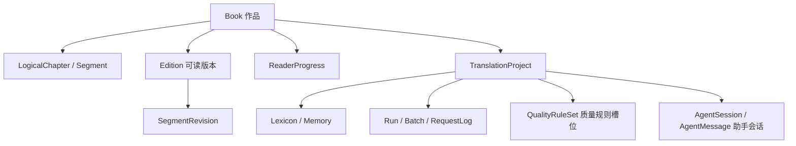
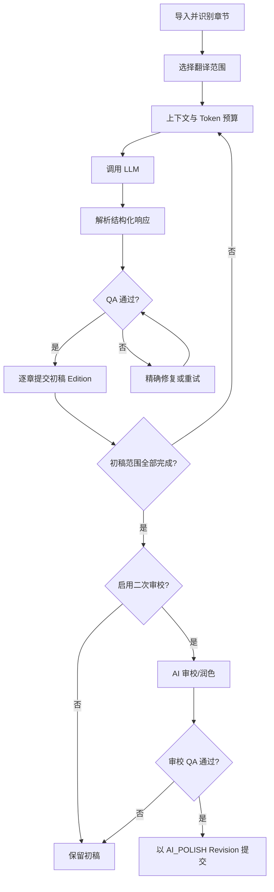
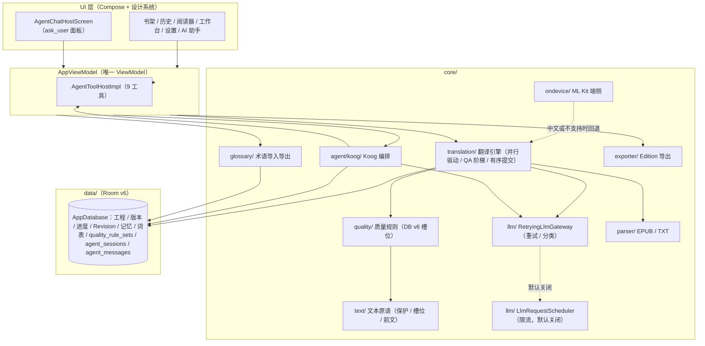

# LightNovelTranslator

> **原生 LG 全面重构进行中（2026-10-24）**：多资产 `.lnt` v4、远程 TXT 批翻、工程规则/提示词、质量检查与筛选、草稿替换、规则/预设/模板库、模型协议/多密钥、工程备份、RGSS 核心和工作区核心已在源码落地；其中 `2643b2c` 的 Actions #146 通过 test/lint/release 与签名校验，§51—70、§72—74 仍未构建（§71/§75 旧迁移已取消）。五协议/密钥池/用量账本、翻译规划/去重/重试/检查点已有独立核心或部分接线，尚未接入完整业务。新增真机/视觉、供应商、Room 2/3/4/5 schema 导出、PDF、工作区生产接线和完整后台恢复仍待完成。完整 S1/S2 与当前范围验收未关闭；`.lg` 工程交换和 Pi 会话兼容已取消。目标见 [重构计划](docs/plans/2026-10-22-native-lg-rebuild/README.md)，唯一当前进度与证据见 [HANDOFF §3、§49](docs/plans/2026-10-22-native-lg-rebuild/HANDOFF.md)。下文为旧阅读平台迁移参考。

> 当前未提交增量见 HANDOFF §51—70、§72—74：新增批翻模式/前文/失败策略/复用、资产与设置、规则/预设/模板库、模型协议与多密钥列、工程备份、RGSS 与工作区核心；原生 `.lnt` 源码升至 v4，应用 Room 源码升至 v5。此增量尚未构建，不属于上述 #146 CI 证据。

LightNovelTranslator 是一款面向长篇小说的 Android 阅读与 AI 翻译应用。它以"书"为中心：导入本地 TXT、EPUB 或粘贴文本后即可阅读；需要翻译时，应用会从原文 Edition 生成一个可持续更新、可校对、可追溯的新 Edition，而不是把书拆成孤立的翻译任务。

项目目前处于早期 Beta 阶段，数据结构和交互仍可能调整。

> **历史构建状态提示（2026-10-19 当时状态，当前证据见顶部交接记录）**：仓库刚完成一轮大规模并行重构（翻译引擎、AI 助手、端侧辅助、设计系统、导入导出、质量规则）。本轮重构**尚未经过任何构建 / 单元测试 / Lint 验证**（受开发环境约束未执行 Gradle），下文描述的行为均以源码与设计文档为依据，首次构建可能需要修复。其中两个默认值变化会直接影响既有工程与新工程的行为，见「翻译引擎配置」。

## 主要功能

- 书架：以封面和书名展示作品，支持改名、更换封面、长按拖拽排序、移出书架和删除。
- 阅读历史：导航栏中位于书架右侧，按最近阅读时间展示书籍、Edition、章节和进度，可直接继续阅读。
- 阅读器：从书架点击书籍即可进入阅读；右上角可进入翻译工作台，阅读底栏提供全书章节进度、前后章跳转、目录和设置。
- 自适应阅读器：支持连续滚动、左右分页、上下分页，以及原文、译文和原译对照；目录从左侧 2/3 屏宽弹出，阅读设置从右侧 2/3 屏宽弹出。
- 阅读设置：支持字体、字号、繁简字、背景、字间距、行间距、段间距和页侧边距，并按书籍保存。
- TXT / EPUB / 粘贴文本导入，保留原始输入、封面和 EPUB 图片资源。
- 导入后先由 TXT / EPUB 解析器建立稳定的章节与 Segment；TXT 格式不规则时可在 V2 工作台显式调用 AI 章节识别，先预览候选边界并确认后再落库，EPUB 则继续使用解析器目录。EPUB 解析基于 jsoup 做块级提取，丢弃 ruby 读音，按 nav / NCX 目录切分章节，并对 zip 结构异常（条目数、解压总量超预算）显式报错。
- 全书、指定章节范围和阅读中无感翻译共用同一翻译引擎。
- 用户可配置每次请求 1–5 章；同一本书默认严格串行，也可按工程配置同书内 1–5 章并行；不同书籍可并发。
- 根据章节内容动态选择已确认术语、Story Memory 和最近章节记忆。
- 本地 QA 检查章节边界、Segment ID、缺段、空输出、异常长度和图片标记，并对局部失败精确修复；术语缺失降级为警告，不再阻断整章提交。
- 专业术语扫描覆盖用户选定范围，兼容常见 JSON 包装与字段别名，结果按工程绑定并去重。
- 任务中心记录状态、Token、费用、模型、供应商、耗时、重试和失败原因。
- 翻译引擎配置：并发章数、前文连续性、章节记忆产出、提示词缓存四个开关，见「翻译引擎配置」。
- AI 助手：对话式查询书架、任务与日志，并在用户确认后执行翻译、术语扫描、章节重分等操作，见「AI 助手」。
- 端侧辅助：在受支持的设备上用 ML Kit GenAI 做章节摘要与译文校对，见「端侧辅助」。
- 导出：TXT / EPUB 可双语导出（原文 + 译文对照），导出前可查看只读预检报告；术语表支持 JSON / CSV 导入导出，见「导出与术语」。
- Debug 模式默认关闭；开启后可在工作台详情中查看完整翻译流程、API 请求与响应、重试轨迹、QA 结论和失败原因。API Key 与 Authorization Header 不会写入 Debug 数据。
- 核心界面提供中文与英文文案。

## 页面结构

手机使用底部导航栏，平板和宽屏使用侧边导航栏，两者顺序一致。

| 页面 | 用途 |
| --- | --- |
| 书架 | 浏览、导入、整理和继续阅读书籍 |
| 阅读历史 | 查看最近阅读记录并回到对应章节 |
| 工作台 | 查看翻译工程、运行状态、成本、日志和 Debug 详情，配置翻译引擎 |
| 设置 | 配置 LLM Provider、显示、语言、日志与 Debug 模式，进入 AI 助手 |

AI 助手是二级页面（路由 `agent?sessionId={sessionId}`），入口有两处：工作台顶栏的助手图标和设置页的「AI 助手」行；不带 `sessionId` 打开时会恢复最近一段会话。

## 领域模型



- `Book` 表示作品本身，保存书名、作者、封面和书架状态。
- `Edition` 是一份具体可读文本，例如导入原文、AI 译文或人工版本；翻译尚未完成时也可以立即阅读。
- `LogicalChapter` / `LogicalSegment` 是跨 Edition 稳定的剧情位置，因此阅读进度不依赖页码、屏幕尺寸或滚动像素。
- `TranslationProject` 描述从源 Edition 到目标 Edition 的翻译配置和运行历史，并持有质量规则槽位（文本保护 / 译前替换 / 译后替换）。
- `SegmentRevision` 保存 AI 初译、自动修复、术语替换和人工编辑历史，避免后台任务静默覆盖用户修改。

完整架构背景见 [Reader & Translation Platform 设计文档](docs/superpowers/specs/2026-08-25-reader-translation-platform-design.md)；本次重构的模块地图与执行流见 [架构总览](docs/plans/2026-10-19-architecture-overview.md)。

## 翻译流程



翻译请求通过短 Segment ID 保持原文与译文边界。正常章节不会预先切块；只有单章确实超过 Token 预算时才启用 Chunk 兜底。合批翻译按章节独立解析、QA 和提交，因此末章截断或后续章节失败不会回滚已经完成的章节，也不会重复计费。

每个工程可配置同书内 1–5 章并行：调度器按章顺序把任务交给有界的工作协程，已完成并通过 QA 的章节按章顺序独立提交；瞬时错误（网络、超时、限流、5xx）在网关重试耗尽后按 15s / 30s / 60s（封顶 120s）退避重排队，最多 5 次，不再中止整个 run；认证、无效请求、本地存储等错误仍然终止 run。

QA 会区分网络、超时、限流、认证、上下文溢出、响应截断、结构解析和译文质量问题。首次 QA 失败优先只修复缺失章节或 Segment；修复仍失败时，任务详情会保留具体检查项和原始错误，而不是只显示笼统的"QA 错误"。局部修复按"对半切"缩小重发范围，单章付费修复请求上限 3 次；已确认术语缺失（`GLOSSARY_MISSING`）降级为警告，章节以"已完成（带警告）"状态提交。

"初稿完成后 AI 二次审校 / 润色"是翻译工程中的可选开关，默认关闭。开启后只在当前翻译范围的初稿全部完成并通过基线 QA 后执行，审校请求使用独立的 `BOOK_POLISH` Prompt；模型失败、结构异常、QA 不通过或章节过长时自动保留初稿，并在任务审计中记录原因。成功结果以 `AI_POLISH` Revision 保存，不会静默覆盖人工编辑或已确认术语替换。

## 翻译引擎配置

工作台配置区新增「翻译引擎」分区，四个开关在任务启动时定格，运行中或已暂停的任务沿用启动时的快照。未创建工程时，当前选择会在创建任务时一并写入。

| 开关 | 默认值 | 行为影响 | 回退方式 |
| --- | --- | --- | --- |
| 并发章数（`parallelChapters`） | 1（串行） | 同书内同时翻译的章节数，1–5。大于 1 时多章并行、按章顺序提交、章间失败隔离；此时"每次请求章数"（`maxBatchChapters`）暂不生效，每章单独成批 | 设回 1 即恢复原有严格串行路径 |
| 前文连续性（`continuityMode`） | `SOURCE_TAIL`（源文前文） | `SOURCE_TAIL` 只把源文尾部作为前文，章节之间无生产依赖，因此可以并行；`TRANSLATION_TAIL` 注入上一章译文作为前文，连贯性优先但章节互相依赖 | 改为 `TRANSLATION_TAIL` 恢复旧行为 |
| 章节记忆与术语候选（`metadataEnabled`） | 关闭 | 开启后每章额外产出章节记忆 / 故事记忆增量 / 术语候选（`<META>` 块），提升后续章节上下文，但每章多花输出 token；关闭时提示词不含 META 规则、解析容忍 META 缺失、落库前跳过元数据写入 | 保持关闭即恢复旧行为的"无显式元数据"路径 |
| 提示词缓存（`promptCacheEnabled`） | 开启 | 请求携带提示词缓存提示：Anthropic 走显式 `cache_control` 断点（ephemeral，约 5 分钟有效），OpenAI / DeepSeek / Gemini 等 shape 的提供方由服务端自动缓存，无需改请求；关闭后重复前缀按全额输入计费 | 关闭开关；未命中缓存时行为与旧版一致 |

> **默认值变化提醒**：本轮重构改变了两个默认值——工程的前文连续性默认从"上章译文"变为"源文前文"（`SOURCE_TAIL`），因此默认不再注入上一章译文；`metadataEnabled` 默认关闭，因此默认不再生成章节记忆与术语候选。这两个字段是 `AppDatabase` v5 新增列（`MIGRATION_4_5`，默认值即 `SOURCE_TAIL` 与关闭），**升级后的既有工程同样适用新默认值**；两者都可以在「翻译引擎」分区改回旧行为。

## AI 助手

AI 助手是一个对话式入口，用于查询与操作本应用的数据，**不实现翻译能力本身**：

- 编排不替代翻译引擎：所有翻译、术语扫描、章节重分都通过工具委托给已有的 `AppViewModel` / 引擎方法执行，助手不并行实现业务逻辑，也不会绕过调度、暂停取消边界与审计链路。
- 工具集（21 个）：查询类 `list_books`、`get_book_status`、`get_recent_log`、`list_glossary`、`get_quality_rules`、`get_translation_cost`、`get_story_memory`；执行类 `start_translation`、`pause_translation`、`resume_translation`、`cancel_translation`、`scan_glossary`、`resplit_chapters`、`create_translation_project`、`add_glossary_entry`、`remove_glossary_entry`、`set_quality_rules`、`export_edition`、`update_translation_config`、`summarize_chapter`；交互类 `ask_user`。覆盖"导入 → 建工程 → 配置 → 翻译 → 术语 → 质量规则 → 导出"的完整流程，用户原则上只需与助手对话即可驱动整个翻译工作流。
- 工具调用双通道：**原生 function calling**（默认开启，OpenAI 兼容形状的 provider 请求携带 tools 数组，由 API 强制调用格式；provider 以 400 拒绝时自动去掉 tools 重试，回合不中断）+ **文本协议兜底**（模型在回复中输出调用块，本地解析执行）。两条路共享同一套执行、回执与历史回路。
- 弱模型适配：解析端对全角字符做归一化，容忍标签变体、散文包裹的 JSON、尾逗号/单引号/无引号键/注释；"想调用但没解析出来"时会先收到一次格式纠正回执而不是被当成最终答复；同一回合内相同调用自动熔断（不重复付费）；答复中的思考块与残留调用块会清洗后再展示。
- 人工确认：会产生付费请求或修改数据的操作（开始翻译、术语扫描、重分章节、修改配置），系统指令要求助手先说明影响并等待用户明确确认；参数不足或需要选择时通过 `ask_user` 提问，问题以底部面板呈现，用户作答或关闭后助手才继续（等待上限 5 分钟）。问题状态由 ViewModel 的 `StateFlow` 持有：切页、旋屏后回到助手仍能看到同一个问题；超时或问答失效时面板自动收起，点"停止"会同时作废待答问题，回合立即结束而不必等满 5 分钟。
- 模型与参数可控：会话启动时解析默认 Provider 及其模型；Agent 页面可切换 Provider/模型、思考强度（off/low/medium/high）与原生工具开关，选择对新对话生效。未配置 Provider 时助手不可用，页面会提示先配置。编排回合固定低温（0.2），格式服从性优先于创意。
- 术语扫描支持章节范围：`scan_glossary` 接受可选 `start_chapter` / `end_chapter`（1 起、含两端，可只给一端），系统指令要求助手先用 `ask_user` 与用户确认范围再扫，越界或倒序的范围会直接回绝并给出该书真实章号区间，不会静默改成别的范围去产生付费请求。
- 多工程消歧：`scan_glossary` 与 `summarize_chapter` 接受可选 `project_id`。该书只有一个翻译工程时自动选中它；有多个工程且未指定时，工具回执会列出全部工程 id 与目标语言并要求助手明确选择，**不会**静默写进第一个工程造成术语/记忆跨版本污染。同样的严格性适用于 `start_translation`：只给 `range_start` 或 `range_end` 的一端时，另一端按"从第一章 / 翻到最后一章"补齐；章号非法或起止倒序会直接回绝，不再静默退回整本翻译。
- 会话管理：会话列表可切换历史会话、开新对话、删除会话（连同全部消息，删除前二次确认）。回合进行中会禁用切换 / 新建 / 删除入口并给出提示——正在跑的回合被换掉会让工具结果失去界面，删除当前会话更会让后续消息写回已删除的行。
- 会话与消息持久化在 `agent_sessions` / `agent_messages` 两张表（数据库 v5 引入），可切换历史会话、开新对话；单回合工具调用上限 6 轮，历史按 12 个回合截断后注入。Token 用量随请求记在它产出的消息行上，重开会话时据此恢复会话累计用量；每次请求（含失败）另写一条 `LLM_AUXILIARY` 日志，可在诊断信息栏与导出日志里核对模型、Token、费用与错误分类。
- 助手只引用工具返回的事实，不编造书籍、章节、进度与 token 用量；不索取或复述 API Key 等凭证。

## 端侧辅助

端侧辅助使用 ML Kit GenAI（Gemini Nano / AICore）在前台交互场景提供章节摘要与译文校对，**目前为模块就绪、尚未接入设置页与阅读器**（见文末「未接线清单」）。其硬限制（依据官方文档，2026-10 核实）：

- 仅 App 前台可推理；后台（含前台服务）返回 `BACKGROUND_USE_BLOCKED`，因此只允许用户主动触发，不做后台批量处理。
- 设备白名单：需要 API 26+ 且 AICore 可用（Pixel 9/10/11、三星 S25/S26 等），不支持已解锁 bootloader 的设备；新设备或重置后 AICore 初始化可能需要数分钟到数小时，使用前必须先探测状态。
- 配额退避：AICore 有每 App 推理配额与电池配额，`BUSY` / `PER_APP_BATTERY_USE_QUOTA_EXCEEDED` 需指数退避（1s/2s/4s/8s 封顶）。
- 语言白名单：摘要仅支持 EN / JA / KO，校对仅支持 EN / JA / DE / FR / IT / ES / KO；**中文一律回退云端模型**（摘要走云端 ContextEngine，校对走云端 Provider）。
- 输入预算：Prompt / 摘要 < 4000 tokens，校对 < 256 tokens；超出按估算分段后逐段处理。
- API 兼容：三个 ML Kit GenAI 包要求 API 26+，应用通过 Manifest 的 `tools:overrideLibrary` 保持 `minSdk 24`，因此所有调用点必须自行守卫 `Build.VERSION.SDK_INT >= 26` 与特性可用性。

## 导出与术语

- **导出**：TXT 与 EPUB 导出默认保持历史行为（每个逻辑段输出有效文本，译文缺失按原文回退）。新增双语导出开关：按逻辑段输出"译文 + 原文"对照段落，EPUB 中原文侧用 `.orig` 样式（灰色、小一号）区分；可选译文在前、合并"译文与原文相同"的段（对应 LG 的 `deduplication_in_bilingual`）；图片可选项控制是否把 EPUB 插图嵌入包内。
- **导出前预检**：只读统计即将导出的章节数、段数、译文缺失回退段、空段、`[IMG:...]` 标记总数与缺失图片标记数、预计字符数；空书或几乎全部回退时判定为阻断问题。预检与导出共用同一套逐章逐段解析逻辑，统计与产物一致。
- **术语导入导出**：术语表可导出为 JSON（带 BOM 可选）或 CSV；导入使用容错 JSON 解析（容忍尾逗号、大小写不敏感的布尔值、包装对象 `{"entries": [...]}`），单条错误只跳过该条并在结果里带行号与原因，不丢失整份文件。导入前提供重复分类预览：`SAME_TARGET`（译文相同，无副作用）、`EXISTING_TARGET_EMPTY`（可补齐）、`INCOMING_TARGET_EMPTY`（覆盖会抹掉既有译文）、`DIFFERENT_TARGET`（冲突），并给出 skip / overwrite 两份快照供确认。
- **预设包**：`assets/glossary/presets/` 内置两个术语预设（示例条目、常用菜单文本），可作为导入源。
- 注意：导出选项 UI、导出前预检 UI 与术语导入导出 UI **尚未接入**，当前 `AppViewModel` 的导出调用使用默认选项（单语导出）；术语文件的读写能力已在 `core/glossary` 就绪但无调用点。

## Provider 与模型

Provider 层支持 OpenAI-compatible 和 Anthropic-compatible API，并提供 DeepSeek、Gemini、Claude、Grok、Kimi、OpenRouter、Ollama 等常用配置模板。用户可以编辑端点、模型、API Key、超时、重试和价格；模型与 Provider 信息会随任务日志保存，便于核对成本和故障。

提示词缓存按 Provider 类型分流：Anthropic 在 system 块与最后一个 user 内容块上打 `cache_control: {"type": "ephemeral"}` 断点；其余 Provider 形状由服务端自动缓存。缓存记录（指纹、token 数、过期时间）落在 `provider_cache_records` 表，仅供审计与统计。

API Key 经应用的安全存储边界读取，不应出现在普通日志、提示词、异常或 Debug 数据中。使用自定义兼容端点时，请确认服务端的请求格式、流式响应和 Token 统计是否与所选协议一致。

## Debug、日志与成本

设置页的 Debug 模式只影响开启后新产生的请求。关闭时仍保留轻量任务状态、Token、费用、错误分类和失败摘要；开启后额外保存 System Prompt、User Prompt、模型响应、重试记录和 QA 原因，并在工作台对应任务详情中按需加载。

Debug 内容可能包含小说正文，请谨慎截图、导出或分享。完整大文本不会进入任务列表的常驻状态，避免日志增长后拖慢页面。

## 技术栈与目录

- Kotlin 2.3.10（KSP 2.3.10）、Jetpack Compose、Material 3
- Room 2.7（`exportSchema = true`，schema 已入库，当前 `version = 6`）
- Coroutines、Flow
- OkHttp、Moshi、`org.json`、jsoup 1.23.2（EPUB 解析）
- Koog 1.3.0（`ai.koog:koog-agents`，AI 助手编排）
- ML Kit GenAI 三个 beta 包（端侧摘要 / 校对 / 通用 Prompt）
- JUnit4、Robolectric、Roborazzi

```text
app/src/main/java/com/breakyuna/noveltranslator/
├── core/
│   ├── agent/          # AgentToolHost（9 工具边界）、章节识别、术语抽取
│   │   └── koog/       # Koog 编排：会话、PromptExecutor 桥接、文本协议工具循环、持久化
│   ├── book/           # BookFileManager（正文/封面/文件唯一管理者）、BookImporter
│   ├── exporter/       # EditionExporter、ExportOptions、ExportContent、ExportPrecheckReport
│   ├── glossary/       # 术语 JSON/CSV 导入导出、容错解析、重复分类预览
│   ├── llm/            # LlmGateway（所有 LLM 调用唯一入口）、LlmClient、RetryPolicy、
│   │                   # TokenCalculator、TranslationPrompts、RequestRatePool、LlmRequestScheduler
│   ├── logger/         # 脱敏系统日志
│   ├── ondevice/       # ML Kit GenAI 端侧辅助：状态探测、摘要、校对、Prompt 轻任务
│   ├── parser/         # TXT / EPUB 解析（jsoup 块级提取、nav/NCX 目录、路径与归一工具）
│   ├── quality/        # 质量规则产品层：规则模型、默认值、解析器、编译执行、校验器
│   ├── sample/         # 示例数据
│   ├── security/       # ApiKeyCipher（Key 加解密边界）
│   ├── text/           # 文本机制原语：保护规则、资源槽位、译前准备、译后恢复、
│   │                   # 字面匹配、术语编译、质量检查、前文构建、保护预设、语言代码
│   └── translation/    # BookTranslationEngine、TranslationProtocol、ContextEngine、QA、
│                       # ScopePlanner、FailurePolicy、TranslationContinuity、ProviderPromptCache
├── data/
│   ├── db/             # AppDatabase（v6）、各 DAO、QualityRuleDao、AgentDao、迁移
│   ├── model/          # Entity、领域模型、轻量查询投影
│   └── repository/     # BookPlatformRepository 等数据边界
└── ui/
    ├── adaptive/       # 窗口尺寸适配
    ├── components/     # 可复用 Compose 组件（apple/ 为唯一组件库）
    ├── i18n/           # AppStrings / PlatformUiStrings / WorkbenchUiStrings /
    │                   # EngineConfigStrings / AgentEntryStrings（纯 Kotlin 双实现）
    ├── navigation/     # 手机底栏、平板侧栏和路由
    ├── screens/        # 书架、历史、阅读器、工作台、设置、AI 助手
    ├── theme/          # DesignTokens + Color / Type / Shape / Spacing + NovelTranslatorTheme
    └── viewmodel/      # AppViewModel（当前唯一 ViewModel）
```

现役架构（本次重构后）：



要点：UI 只经 `AppViewModel` 触达数据与引擎；`AgentToolHostImpl` 把每个助手工具委托给既有 ViewModel / 引擎方法；`core/text` 是纯 JVM 原语（无 Android 依赖，可单测），`core/quality` 是它的产品层（落库 + 默认值 + 校验）；`core/ondevice` 目前没有任何调用点。

## 数据与文件

Room 保存关系、状态、阅读进度、Revision、Memory、Lexicon、任务和审计数据；正文和二进制资源由文件管理层保存。当前 beta 使用独立的平台数据库文件，不再加载旧版项目、章节或任务表。

数据库当前 `version = 6`：v5 引入 `agent_sessions` / `agent_messages` 两张表与翻译工程的 4 个引擎开关列；v6 引入 `quality_rule_sets`（文本保护 / 译前替换 / 译后替换三个槽位，复合主键为工程 + 槽位）。迁移 `MIGRATION_4_5` / `MIGRATION_5_6` 在 `AppDatabase.getDatabase()` 手动注册，schema JSON 位于 `app/schemas/`。

```text
files/books/book_<id>/
├── cover/
├── source/
├── shared/images/
├── editions/edition_<id>/chapters/
└── workspace/

cache/books/book_<id>/       # 可重建内容
files/exports/book_<id>/     # Edition 导出
```

## 本地开发

工具链要求：

- JDK 17（AGP 9.1.1 要求 JDK 17；Koog 发行物为 Java 17 字节码），`sourceCompatibility` / `targetCompatibility` / `jvmTarget` 均为 17。
- Kotlin 2.3.10、KSP 2.3.10、AGP 9.1.1，依赖一律走 `gradle/libs.versions.toml`（`settings.gradle.kts` 设置 `FAIL_ON_PROJECT_REPOS`，模块脚本里不得写 `repositories {}`）。
- SDK：`minSdk 24`、`targetSdk 36`、`compileSdk 36 (minorApiLevel 1)`；`versionCode` 本地为 7，CI 取 `GITHUB_RUN_NUMBER`。

本轮新增依赖（均已在 catalog 与 `app/build.gradle.kts` 声明）：

- `ai.koog:koog-agents:1.3.0`：AI 助手编排层，自带 Jackson 传递依赖，因此 Manifest 的 `tools:overrideLibrary` 需要放行 `com.fasterxml.jackson.*`。
- `org.jsoup:jsoup:1.23.2`：EPUB 块级正文与目录解析。
- `com.google.mlkit:genai-prompt:1.0.0-beta4`、`genai-summarization:1.0.0-beta1`、`genai-proofreading:1.0.0-beta1`：端侧 GenAI，均要求 API 26+，同样经 `tools:overrideLibrary` 放行。

常用验证命令：

```bash
./gradlew testDebugUnitTest lintDebug assembleDebug
```

跑单个测试类：

```bash
./gradlew testDebugUnitTest --tests "com.breakyuna.noveltranslator.core.translation.TranslationProtocolTest"
```

改动 UI 后重新录制 Roborazzi 截图：

```bash
./gradlew recordRoborazziDebug
```

如需在本地生成签名 Release APK，请提供：

```text
ANDROID_KEYSTORE_PATH
ANDROID_KEYSTORE_PASSWORD
ANDROID_KEY_ALIAS
ANDROID_KEY_PASSWORD
```

## 未接线清单（下次构建前的已知缺口）

本轮重构后仍处于"模块就绪、未接线"状态的能力，构建通过后按此清单接线（详细步骤见架构总览文档）：

- ~~`assets/agent/system-prompt.md` 未接线~~（已修复：`AppViewModel` 构造 `AgentChatController` 时传入 `AssetsAgentPromptLoader`，资产提示词生效，兜底指令仅在资产缺失时使用）。
- `LlmRequestScheduler` / `RequestRatePool` 已就绪，但 `RetryingLlmGateway` 未注入调度器（默认 `null`），RPM/RPS 限流、429 冷却与并发自动升降整体关闭。
- 质量规则（DB v6）已有读写与解析链路，但没有设置页 UI。
- 导出选项与导出前预检已有 core 实现，`AppViewModel` 仍按默认选项调用（单语导出）。
- 术语导入导出（`core/glossary`）无任何调用点与 UI。
- ML Kit 端侧辅助（`core/ondevice`）无任何调用点，未接设置页开关与阅读器入口。
- `core/text` 中除 `PrecedingContextBuilder`、`TextProtectionRule`（掩蔽热路径）、`TextProtectionPresets`、`LiteralMatcher`（均已经由 `core/quality` 接入）外的原语（译前准备、译后恢复、资源槽位、术语编译、质量检查、语言代码）尚未接入引擎管线。
- 全书写校对台（跨书问题清单视图）未开始。

> **首次构建的高优先风险**：`core/text` 的保护正则前置了 `(?U)` 标志，据 `core/quality/QualityRuleEngine.kt` 的注释记录，Android 14（API 34）起 `java.util.regex` 改由 ICU4C 实现后该标志会抛 `PatternSyntaxException`；该路径已在每章每段的文本保护热路径上，且 Robolectric（JVM 正则）测不出。首次构建通过后请在 API 34+ 真机跑一次单章翻译验证（细节与缓解见架构总览文档 §8 R1）。

## GitHub Actions

工作流位于 [`.github/workflows/android.yml`](.github/workflows/android.yml)。向 `main` 或 `beta` 分支提交（push）会自动执行单元测试、Lint 和签名 Release APK 构建，也可以通过 `workflow_dispatch` 手动运行。

仓库需要配置以下 Actions Secrets：

```text
ANDROID_KEYSTORE_BASE64
ANDROID_KEYSTORE_PASSWORD
ANDROID_KEY_ALIAS
ANDROID_KEY_PASSWORD
```

工作流会验证固定签名证书的 SHA-256、使用 `apksigner` 校验产物，并上传带分支名的签名 APK artifact。`versionCode` 在 CI 中使用 `GITHUB_RUN_NUMBER`，确保后续构建可以覆盖安装。

## 贡献与约束

提交代码前请阅读 [`AGENTS.md`](AGENTS.md)。涉及数据模型的改动必须同步当前数据库实体、DAO 投影和 schema；涉及顶级页面的改动必须同时更新手机底栏、平板侧栏与 `NavHost`。用户可见文案必须同时补 `ChineseStrings` 与 `EnglishStrings`（或对应的字符串对象）。

## License

[Apache License 2.0](LICENSE)
