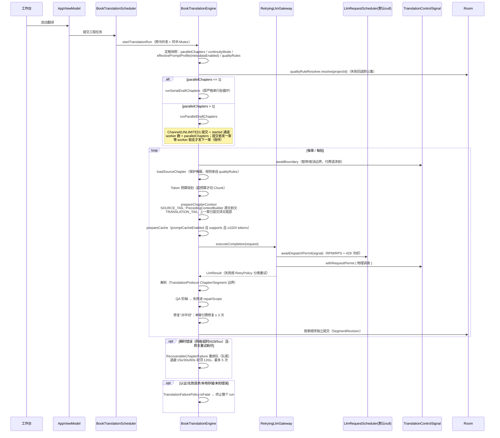
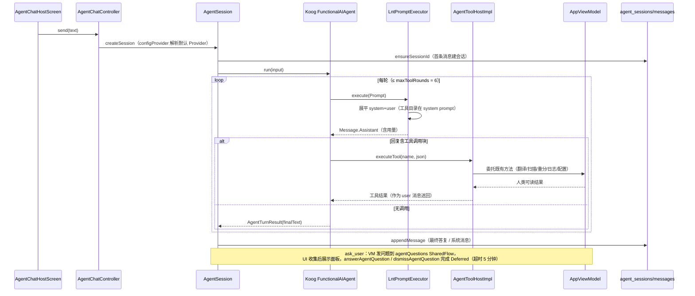

# 架构总览：2026-10-19 大规模重构后

> 类型：给未来会话 / 维护者的架构说明文档（不是计划，不是验收报告）
> 日期：2026-10-19
> 对象仓库：`/data/data/com.termux/files/home/LightNovelTranslator`
> 约束：本次重构**未执行任何 gradle / 构建 / 测试 / Lint 命令**（开发环境明令禁止）。本文所有断言来自对工作区源码的静态核对（`rg` / `read`），凡无法从代码直接确认的一律标注「待验证」。
> 上游文档：`docs/plans/2026-10-19-master-refactor-plan.md`（重构计划与执行状态）、`docs/plans/lg-parity-gap-analysis.md`（与 LinguaGacha 的功能对标审计）、`README.md`（用户向说明）、`AGENTS.md`（仓库规范）。`REFACTOR_REPORT.md` 是 2026-08-24 历史快照，不作为现行架构清单。

## 0. 读前须知：三个必须记住的事实

1. **全部改动未提交、未构建。** `git status` 显示 39 个已修改文件 + 44 个未跟踪文件/目录（含 `app/schemas/.../5.json`、`6.json`）。首次构建由用户执行，预期需要修复的点见 §7。
2. **「模块就绪」与「已接线」是两件事。** `core/glossary`、`core/ondevice`、限流调度器、`core/text` 的 6 个模块都只有测试调用点、主源码零调用；`core/text` 另外 4 个模块（`TextProtectionRule` / `TextProtectionPresets` / `PrecedingContextBuilder` / `LiteralMatcher`）已经接线。接线清单见 §6。判定某能力是否可用，唯一可靠方法是 `rg` 查主源码调用点，不要读计划文档的状态列。
3. **两个默认值行为变化影响所有工程（含升级后的旧工程）。** `continuityMode` 默认 `SOURCE_TAIL`（不再注入上一章译文）、`metadataEnabled` 默认 `false`（不再产出 META / 章节记忆 / 术语候选）。二者是 `MIGRATION_4_5` 的新列默认值，不是新工程专属。

---

## 1. 模块地图

依赖方向总原则：`ui → viewmodel → repository/dao → core/*`；`core/*` 之间只有单向依赖（`quality → text`、`translation → quality/text/llm`、`agent/koog → llm + agent`）；`core/text` 与 `core/ondevice` 的纯逻辑部分不依赖 Android framework（可纯 JVM 单测）。

### 1.1 `core/text/`（10 个文件，纯 JVM 原语，移植自 LinguaGacha）

| 文件 | 关键类型 / 入口 | 职责 |
| --- | --- | --- |
| `TextProtectionRules.kt` | `TextPreserveEntry`、`TextPreserveAnalysis`、`TextProtectionRule` | 保护段裁决（重叠按定义序）、`transformUnpreserved` 把保护段替换为等长空白 |
| `TextProtectionPresets.kt` | `TextProtectionPresets.base()` | 内置基础规则（` `、`\s`、资源 token）。未移植 KAG/RENPY/RPGMAKER/WOLF 引擎预设（面向小说正文） |
| `ResourceReferenceSlots.kt` | `ResourceReference`、`ResourceReferenceMapping`、`ResourceReferenceProjection`、`TOKEN_PREFIX` | 文本内资源引用（图片/URI）投影为临时 token 与译后恢复 |
| `TranslationSourcePreparer.kt` | `PreparedSourceLine` / `PreservedSourceLine` / `TranslatableSourceLine`、`TextReplacementEntry`、`TextReplacements`（约 225-304 行） | 译前准备：保护分析 + 译前替换 + 首尾空白剥离 |
| `PostTranslationRestorer.kt` | 恢复入口（圆圈数字、引号、空白回包） | 译后恢复：把译文映射回源文形式 |
| `LiteralMatcher.kt` | `LiteralPattern`、`TextRange`、`LiteralPatternMatch`、`compileLiteralPatterns` | Aho–Corasick 多模式字面匹配（NFKC + casefold，无正则） |
| `GlossaryCompiler.kt` | `GlossaryEntry`、`GlossarySourceMatch`、`GlossaryApplication` | 术语编译与命中应用 |
| `TranslationQualityRules.kt` | `QualityIssueCode`（FOREIGN_RESIDUE / PUNCTUATION_STRUCTURE / TRANSLATION_SIMILAR / LINE_COUNT_MISMATCH / PARAGRAPH_COUNT_MISMATCH）、`QualityIssue` | 译文质量检查规则 |
| `PrecedingContextBuilder.kt` | `PrecedingSourceLine`、`PrecedingContextBuilder.build()` | 源文前文构建（只取以句末标点结尾的行、不跨来源），是并行翻译的前提。**已接线**（引擎唯一直接调用的 `core/text` 模块） |
| `LanguageCodes.kt` | `SOURCE_LANGUAGE_CODES`、`ALL_LANGUAGE_CODE` | 书写系统词表与目标语言分类 |

生产调用点（4/10 已接线）：`PrecedingContextBuilder`（`core/translation/BookTranslationEngine.kt:1126`）、`TextProtectionRule` / `TextPreserveEntry`（经 `core/translation/TranslationTextProtection.kt:42-44`、`100-108` 进入每章每段的掩蔽热路径，见上方地雷）、`TextProtectionPresets`（`core/quality/QualityRuleDefaults.kt:50`）、`LiteralMatcher`（`core/quality/QualityRuleEngine.kt:3`）。其余 6 个模块（`ResourceReferenceSlots`、`TranslationSourcePreparer`、`PostTranslationRestorer`、`GlossaryCompiler`、`TranslationQualityRules`、`LanguageCodes`）只有 `app/src/test/.../core/text/**` 的测试引用（118 个 `@Test`）。接线位置已在引擎留好（`PostTranslationRestorer.kt:90-93` 附近有调用点注释），接入步骤见 §6.7。

> 平台地雷（**已在生产热路径上，不是未来风险**）：`core/text` 的 `TextProtectionRule` 会给每条模式前置 `(?U)`（UNICODE_CHARACTER_CLASS，`TextProtectionRules.kt:56`）。桌面 JVM 支持它，但 `core/quality/QualityRuleEngine.kt:1-40` 的注释记录：**Android 14（API 34）起 `java.util.regex` 改由 ICU4C 实现**，ICU 内联标志只接受 `i d m s u w x -`，`U` 会抛 `PatternSyntaxException`。该风险的两个失败模式（都待 API 34+ 真机验证，Robolectric 跑在 JVM 正则上测不出来）：
> 1. 引擎掩蔽路径（`BookTranslationEngine.kt:1393-1395` → `TranslationTextProtection.protect(text, entries)` → `ruleFor()`）有 `runCatching` 兜底：异常时**静默降级为不保护**，`[IMG:...]` 等标记原样进模型，质量退化但不崩溃；
> 2. QA 的 `tokenValues()` 走 `protect(text)` → `defaultRule`（`TranslationTextProtection.kt:42-44`，`by lazy` **无兜底**）：首次调用即抛，按 `TranslationFailurePolicy` 属于 UNKNOWN 类致命错误，**可能直接终止整个 run**。
>
> 接线 `core/text` 其余模块前，必须先去掉 `(?U)`（或改本地编译），并给 `defaultRule` 加兜底。详见 §8 R1。

### 1.2 `core/quality/`（5 个文件，质量规则产品层，DB v6）

- `QualityRuleModels.kt`：三槽位模型 `QualityRuleType` = `TEXT_PRESERVE` / `PRE_REPLACEMENT` / `POST_REPLACEMENT`（术语表槽位由 `LexiconEntryEntity` 承担，不重复建模）；槽位开关 + `QualityRuleMode`（保护三态 `OFF/SMART/CUSTOM`；替换两态 `LITERAL/REGEX`）；`QualityRuleJson` 编解码。
- `QualityRuleDefaults.kt`：默认值唯一定义处。`textPreserveBaseRules` 把 `core/translation/TranslationTextProtection` 原先的硬编码 alternation 每个分支原样收编为一条 `TextPreserveEntry`（前 5 条按旧分支顺序排列，保证同起点冲突裁决一致）；`defaultRuleSets()` = TEXT_PRESERVE 开 / SMART / 空条目，PRE 与 POST 关 / CUSTOM / 示例条目（`enabled = false`，升级不悄悄改写正文）；`fallbackResolvedRules()` = 读不到数据时的回退（旧工程行为与升级前逐字节一致）。
- `QualityRuleResolver.kt`：`ResolvedQualityRules`（一次运行内的规则快照）+ `resolve(projectId)`，失败回退默认集。
- `QualityRuleEngine.kt`：编译与执行；明确避开 `(?U)`；保护掩蔽按定义序合并成一条 alternation 后本地编译。
- `QualityRuleValidator.kt`：保存期校验（ERROR 阻止保存 / WARNING 提示），上限：单集 200 条、模式 500 字符、替换文本 2000 字符。

落库：`data/model/QualityRuleEntities.kt` 的 `QualityRuleSetEntity`（表 `quality_rule_sets`，复合主键 `translationProjectId + type`，FK CASCADE，`entriesJson` 为 Moshi 序列化，`revision` 自增）；DAO 为 `data/db/QualityRuleDao.kt`。

### 1.3 `core/glossary/`（3 个文件，术语文件层，**未接线**）

`GlossaryTransferEntry`（与 Room id、工程解耦的传输形态）、`GlossaryIo`（`exportToJson` / `exportToCsv`（带 BOM 选项）/ `parseImportJson` / `previewImport`）、`LenientJson`（带行号的容错 JSON：跳过坏元素并报告、容忍尾逗号、布尔大小写不敏感、未知转义按字面保留）。重复四分类：`SAME_TARGET` / `EXISTING_TARGET_EMPTY` / `INCOMING_TARGET_EMPTY` / `DIFFERENT_TARGET`；导入动作 `ADD` / `SKIP` / `OVERWRITE`。预设包：`app/src/main/assets/glossary/presets/01_示例.json`、`02_常用菜单文本.json`。22 个 `@Test`。**主源码零调用点。**

### 1.4 `core/ondevice/`（10 个文件，ML Kit GenAI 端侧辅助，**未接线**）

`OnDeviceAssistGateway`（门面，实现 `OnDeviceAssistPort`：`summarizeChapterForMemory` / `proofreadTranslation`，返回 null = 回退云端）、`OnDeviceGenAiStatus`（能力探测，`ON_DEVICE_GENAI_MIN_API_LEVEL = 26`）、`OnDeviceSummarizer`、`OnDeviceProofreader`、`OnDevicePromptClient`（术语抽取 / 标题翻译轻任务）、`OnDeviceTokenBudget`（摘要 < 4000 tokens、校对 < 256 tokens、安全上限 3500）、`OnDeviceErrors`（统一错误分类 + 1s/2s/4s/8s 退避）、`OnDeviceFutures`（`ListenableFuture` → suspend 桥接，避免依赖 kotlinx-coroutines-guava）、`OnDeviceLanguageSupport`（摘要 EN/JA/KO，校对 EN/JA/DE/FR/IT/ES/KO）、`OnDevicePromptAssets`（`assets/ondevice/prompts/*.txt`，`{{KEY}}` 模板）。38 个 `@Test`。**`AppViewModel` 无任何引用**（`rg onDevice|OnDevice` 仅命中自身目录）。

### 1.5 `core/agent/` 与 `core/agent/koog/`（AI 助手，11 + 1 个文件）

- `core/agent/AgentToolHost.kt`：工具边界。接口 9 个方法 + `toolSpecs()`（渲染进 system prompt 的稳定目录）+ `executeTool(name, argumentsJson)`（参数解析、校验、错误信封 `AgentToolOutcome.failure/success` 全实现于此，任何实现免费获得一致行为）。工具名常量见 companion。
- `koog/AgentSession.kt`：一个对话会话。持有 Koog `FunctionalAIAgent<String, AgentTurnResult>`；`send()` 串行执行；`cancel()` 只置 `TranslationControlSignal`；历史按 `maxHistoryTurns` 截断后每轮灌入（Koog 每次 run 从初始 prompt 重建）；`ensureAgent()`（231-263 行）组装 `LLModel`（自建 `LntLlmProvider` 子类，capabilities 仅 `Temperature`）+ `LntPromptExecutor` + `lntAgentStrategy` + `ToolRegistry.EMPTY`（工具走文本协议，不用 Koog 原生工具）。
- `koog/LntPromptExecutor.kt`：Koog `PromptExecutor` → LNT `LlmGateway` 桥。不做原生 function calling：把 Koog 多消息 `Prompt` 展平成 system + user 两段文本，`LlmResult` 转回 `Message.Assistant` 并带 token 用量；失败抛 `AgentLlmFailureException`（只带分类与消息，不带正文）。
- `koog/AgentTurnStrategy.kt`：文本协议工具循环：灌历史 → 请求 → 解析工具调用块 → 有调用经 `AgentToolHost.executeTool` **串行执行**（副作用必须串行）并把结果作为 user 消息送回 → 无调用即最终答复。每轮工具执行前检查取消信号。
- `koog/AgentPrompts.kt` + `AssetsAgentPromptLoader.kt`：`SYSTEM_PROMPT_ASSET = "agent/system-prompt.md"`；`resolveBasePrompt` 优先 override → asset → 内置兜底。**`AssetsAgentPromptLoader` 无构造点**，asset 目前是死资源（见 §6.1）。
- `koog/AgentSessionStore.kt` / `RoomAgentSessionStore.kt`：会话与消息持久化（`agent_sessions` / `agent_messages`，消息 FK CASCADE）。
- `koog/AgentModels.kt`：`AgentSessionConfig`（`maxToolRounds = 6`、`maxHistoryTurns = 12`、`compressAfterMessages = 24`、`maxTranscriptChars = 60_000`、`maxTokens = 2048`、`temperature` 默认 0.4 且 `effectiveTemperature` 在 provider 温度 ≤ 0 时兜底）、`AgentTurnSink`、`AgentTurnResult`、`AgentSessionState`。
- `koog/AgentProtocolModels.kt` / `AgentToolProtocol.kt`：工具调用 / 结果块的文本协议编解码。

UI：`ui/screens/agent/`（`AgentChatController` 依赖全部外部注入、`AgentChatHostScreen` 宿主 + `ask_user` 底部面板 + 会话切换 sheet、`AgentChatScreen` 纯展示、`AgentChatStrings` 自带中英）。入口：工作台顶栏图标（`BookWorkbenchDetailScreen.kt:310`）与设置页行（`ApiSettingsScreen.kt:198`），路由 `agent?sessionId={sessionId}`（`AppDestination.kt:29-30`，`AppNavigation.kt:226-238`）。测试：6 个新文件 93 个 `@Test`。

### 1.6 `core/llm/` 限流层（`RequestRatePool.kt` + `LlmRequestScheduler.kt`，**默认关闭**）

- `RequestRatePool.kt`：`RequestLimits(autoConcurrency, concurrencyLimit, rpmLimit)`、`resolveRequestLimits(provider)`（云端 `CLOUD_RPM_LIMIT = 60`；本地 `LOCAL_CONCURRENCY_LIMIT = 8`）、`RequestRate`（RPM 派发间隔 = 60000/rpm + 隐藏 RPS 令牌桶）、`RequestRatePool`（按 provider 维度复用，键与工厂一致）。
- `LlmRequestScheduler.kt`：单 Key 冷却阶梯 `15s/30s/60s`；`onSuccess` 连续成功 +1、自动模式并发 +1（封顶 16）；`onFailure(RATE_LIMIT)` 并发减半（不低于 1）+ `concurrencyVersion++`（隔离降档前在途请求）+ 冷却 `max(阶梯, Retry-After)`；`SchedulerFailureVerdict`（TRANSIENT / TERMINAL / IGNORED）；`LlmRequestSchedulerFactory` 按 provider 复用调度器。
- 接线缝：`RetryingLlmGateway` 第二构造参数 `scheduler: LlmRequestScheduler? = null`（`LlmGateway.kt:195`、`271`）；`null` 时行为与历史完全一致。测试：`RequestRatePoolTest`（8）、`LlmRequestSchedulerTest`（16）、`RetryingLlmGatewaySchedulerTest`（6）。

### 1.7 引擎侧改动（`core/translation/`）

- `TranslationContinuity.kt`：`SOURCE_TAIL` / `TRANSLATION_TAIL` 常量与集合。
- `ProviderPromptCache.kt`：`ProviderPromptCacheCapability` 接口 + `AnthropicPromptCacheCapability`（显式缓存，TTL 5 分钟，无 create-cache 端点，断点即缓存）+ `AutomaticPromptCacheCapability`（非 Anthropic 非 Ollama 的全部 provider）+ `CompositePromptCacheCapability`（按 provider 分发）+ `PromptCachePolicy.shouldCreate`（稳定前缀 ≥ 1024 tokens 且预期复用 ≥ 2 次才建）。`cache_control` 的实际发射在 `LlmClient.kt:470-496`（system 块 + 最后一个 user 内容块各一个 ephemeral 断点）。
- `TranslationFailurePolicy.kt`：`FATAL_CATEGORIES` = AUTHENTICATION / INVALID_REQUEST / LOCAL_STORAGE / UNKNOWN；其余（网络、超时、限流、服务端）为可恢复。
- `TranslationTextProtection.kt`：掩蔽执行体**委托**新体系（`QualityRuleDefaults.textPreserveBaseRules`），保留两个关键语义：空白段不掩蔽、按源文顺序编号；标记格式 `__LNT_PROTECTED_n__` 不变（QA `PROTECTED_TOKEN_CHANGED` 与分块预算的契约）。
- `BookTranslationEngine.kt`：并行驱动、失败重排队、QA 阶梯、META 门控（见 §2）。

### 1.8 导入 / 导出 / 数据 / UI

- `core/parser/`：`EpubPaths`（zip 内 POSIX 路径解析）、`EpubHtmlExtractor`（块级提取 + 标题层级/id + ruby 读音丢弃）、`EpubTocParser`（EPUB3 nav 与 EPUB2 NCX，jsoup HTML 容错解析，目录标题优先于正文标题）、`ImportTextNormalizer`（EPUB/TXT 统一归一：行内空白不压缩、`&nbsp;` → 普通空格、连续空行折叠、EPUB 块级去首尾空白而 TXT 不修剪）。`EpubParser` 预算：单文件 100 MB、单条目 25 MB、解压总量 250 MB、条目数 10_000。测试：5 个新文件 48 个 `@Test`。
- `core/exporter/`：`ExportOptions`（`bilingual` / `translationFirst` / `deduplicateIdentical` / `includeImages`，默认值逐字节复现历史单语导出）、`ExportContent`（确定性、无 IO 的段/章/块渲染与统计）、`ExportPrecheckReport`（只读预检 + `hasBlockingIssues`）、`EditionExporter.precheck()`；双语 EPUB 原文侧用 `.orig` 样式（`EditionExporter.kt:55-56`）。测试 20 个 `@Test`。
- `data/`：`AppDatabase` `version = 6`，22 个实体；`MIGRATION_4_5`（4 个工程列 + `translation_prompt_profiles.includeMetadataRules` + agent 两张表）、`MIGRATION_5_6`（`quality_rule_sets`）；schema `app/schemas/.../{1,3,4,5,6}.json`；`sourceSets.test.assets` 含 schema 目录供 Migration 测试。
- `ui/theme/`：`DesignTokens.kt`（`AppColors` 语义色 + `LocalAppColors`、`Motion` 90/140/220ms、`Elevation`）+ Color / Type / Shape / Spacing；`ui/components/apple/AppleComponents.kt`（640 行，15 个 `App*` 组件：`AppLargeTitle`/`AppCard`/`AppGroupedSurface`/`AppHeroCard`/`AppBadge`/`AppSectionHeader`/`AppSection`/`AppDivider`/`AppSettingsRow`/`AppSegmentedControl`/`AppStatusRow`/`AppPrimaryButton`/`AppSecondaryButton`/`AppEmptyState`/`AppIconBubble`）为唯一组件库；`ui/screens/workspace/EngineConfigurationSection.kt` 为「翻译引擎」配置分区；i18n 新增 `EngineConfigStrings`（23 项）、`AgentEntryStrings`（12 项）、`WorkbenchUiStrings`（255 项）三个字符串对象，`AppStrings` / `PlatformUiStrings` 同步扩充（diff 合计 +419 行）。全仓新增测试文件 31 个、`@Test` 369 个（未执行）。

---

## 2. 翻译执行流（含并行模式完整时序）

关键实现位置与语义（除注明外，行号均指 `core/translation/BookTranslationEngine.kt`）：

1. **快照定格**（`BookTranslationEngine.kt:347-392`）：`parallelChapters`（`coerceIn(1,5)`）、`continuityMode`、`effectivePromptProfile`（`metadataEnabled = false` 时 `copy(includeMetadataRules = false)`，模型不会收到 META 规则）、`qualityRules` 在 run 开始时定格，运行中改配置不影响本次 run。并行开启且 `maxBatchChapters > 1` 时打警告：每章单独成批。
2. **串行 / 并行驱动**（`:558-580`、`:640-700`）：`runParallelDraftChapters` 用 `Channel<LogicalChapterEntity>(UNLIMITED)` + `started` 通道实现"提交者发一章、等 worker 取走才发下一章"的保序提交；`parallelChapters` 个 worker 并行消费；每个 worker 在付费请求前过 `awaitBoundary`。
3. **三层门**（请求发出前）：
   - `RetryingLlmGateway`（`LlmGateway.kt:186-230`）：取消检查 → `awaitResume` → 重试循环，`RetryPolicy.decide` 按分类给 maxAttempts（RATE_LIMIT/NETWORK/TIMEOUT 5 次、SERVER_ERROR 4 次、EMPTY/PARSE 3 次、CONTEXT_OVERFLOW 1 次、QUALITY_REJECTED 2 次），指数退避封顶 60s + 抖动，尊重 `retryAfterMs`；
   - `LlmRequestScheduler`（可选，当前为 `null`）：`awaitDispatchPermit(signal)` 先等速率/冷却，再放行；
   - `TranslationControlSignal`：`withRequestPermit` 注册在途请求，暂停/取消在物理调用前后都生效，取消后不会再有新付费请求。
4. **上下文**（`:1086-1107`）：`SOURCE_TAIL` 走 `loadPrecedingSourceTail`（`PrecedingContextBuilder(threshold = 24)`，只收以句末标点结尾的行，兜底 `takeLast(900)` 字符，无完整句时退化为原始尾部）；`TRANSLATION_TAIL` 走 `loadPreviousContextTails`（读上一章已提交译文）。
5. **QA 阶梯**（`TranslationProtocol.kt` + `:2034-2075`）：确定性 QA（缺段 / 空输出 / 异常长度 / 拒答 / 图片标记 / 术语违规）→ `repairScope`（局部段集合；`GLOSSARY_MISSING` 按章级报告，修复时重发所有"源文含已确认术语而译文不含"的段）→ 对半切（`affected` 取前一半、后一半、最后整章，`MAX_PAID_REPAIRS_PER_CHAPTER = 3`）。
6. **术语缺失降级**：`GLOSSARY_MISSING` 进入 `warningMessages()`，章节以 `COMPLETED_WITH_WARNINGS` 提交（`:2685-2692`），不再阻断。
7. **META 门控**：`metadataEnabled = false` 时提示词无 META 规则（`:351-355`）、解析容忍缺失（`TranslationProtocol.kt:102-117`）、落库前跳过 `applyMetadata` 与章节记忆写入（`:2694-2700`）。
8. **有序提交与失败隔离**：每章独立解析 / QA / 提交；瞬时错误重排队不中止 run（最多 5 次，`MAX_RECOVERABLE_CHAPTER_FAILURES = 5`，退避梯 `RECOVERABLE_BACKOFF_MS = 15s/30s/60s`，封顶 `120s`，尊重 `retryAfterMs`）；致命错误（`TranslationFailurePolicy.isFatal`）才终止 run。
9. **Chunk 兜底**：仅单章超 Token 预算时启用，checkpoint 文件（`.translation_checkpoint_<project>_<chapter>.txt`）带源文/计划指纹，恢复时校验指纹，已完成 chunk 不重复计费。

---

## 3. Agent 运行时

- **桥接边界**：`LntPromptExecutor` 是 Koog 与 LNT 的唯一接触点；provider / 模型 / 温度 / token 上限来自 `AgentSessionConfig`（会话启动时解析设置里的默认 Provider，未配置则页面提示）；取消信号经 lambda 动态读取，`cancel()` 后不会有新的付费请求，与翻译引擎的暂停/取消边界一致。
- **文本协议工具循环**：因为 `LlmGateway.executeCompletion` 是单轮请求-响应、没有 tools 参数，所以不走原生 function calling；工具目录以 JSON Schema 文本写进 system prompt（`assets/agent/system-prompt.md` 的「工具使用节奏」段规定：查询类可连续调用，执行类一次一个且先确认）。
- **持久化**：`RoomAgentSessionStore(db.agentSessionDao(), db.agentMessageDao())`；消息角色 USER / ASSISTANT / TOOL_CALL / TOOL_RESULT / SYSTEM，工具调用与结果按协议块原样存储，重开会话可重建；会话 `updatedAt` + `lastMessagePreview` 供列表展示。
- **ask_user 流**：`AgentToolHostImpl.askUser`（`AppViewModel.kt:427-432`）把问题 emit 到 `agentQuestions`（`MutableSharedFlow(extraBufferCapacity = 8)`）并 `withTimeout(5 * 60 * 1000)` 等待 `CompletableDeferred`；`AgentChatHost.kt:103-132` 收集问题展示底部面板，作答 / 关闭分别走 `answerAgentQuestion` / `dismissAgentQuestion`（后者完成时常量为「用户关闭了提问，未作答。」）。
- **历史压缩**：回合内消息超过 `compressAfterMessages = 24` 触发一次 Koog 历史压缩（压缩本身是一次付费请求，`onCompressed` 只记日志）。

---

## 4. 配置矩阵（4 个引擎开关）

落库位置：`TranslationProjectV2Entity`（`data/model/ReaderPlatformEntities.kt:186-195`），`init` 约束 `parallelChapters in 1..5`。

| 开关 | 列 / 类型 | 默认值 | 行为影响（代码位置） | 回退方式 |
| --- | --- | --- | --- | --- |
| 并发章数 | `parallelChapters` Int | 1 | `>1` 时有界并发 + 保序提交 + 章间失败隔离；`maxBatchChapters` 暂不生效（`:356-365`）。串行路径 `<=1`（`:575`） | 设回 1 |
| 前文连续性 | `continuityMode` String | `SOURCE_TAIL` | `SOURCE_TAIL` 前文仅取自源文，章节无生产依赖，可并行（`:1099-1106`）；`TRANSLATION_TAIL` 注入上一章译文，章节互相依赖（`:1090-1098`） | 切到 `TRANSLATION_TAIL` |
| 章节记忆与术语候选 | `metadataEnabled` Boolean | false | 提示词不含 META 规则（`:351-355`）、解析容忍 META 缺失（`TranslationProtocol.kt:102-117`）、跳过元数据写入与章节记忆落库（`:2694-2700`） | 开启 |
| 提示词缓存 | `promptCacheEnabled` Boolean | true | 携带 `PromptCacheHint`：Anthropic 打 ephemeral 断点（`LlmClient.kt:470-496`），其余 provider 服务端自动缓存；稳定前缀 <1024 tokens 或预期复用 <2 次不建缓存（`PromptCachePolicy.shouldCreate`） | 关闭 |

UI：`EngineConfigurationSection.kt`（`EngineConfigDraft` 为草稿值对象；工程已存在时自己保存到 `updateTranslationProjectConfig`，未建工程时经 `onDraftChange` 交给创建入口 `configureEditionTranslation`）。Agent 侧同名工具 `update_translation_config` 走 `AppViewModel.kt:438-471`（运行中 / 已暂停拒绝修改，`continuityMode` 非法值归一为 `SOURCE_TAIL`，`parallelChapters` `coerceIn(1,5)`）。

---

## 5. 数据库迁移链

| 版本 | 变更 | 注册 |
| --- | --- | --- |
| 4 → 5 | `translation_projects_v2` 加 4 列（`parallelChapters` DEFAULT 1、`continuityMode` DEFAULT 'SOURCE_TAIL'、`metadataEnabled` DEFAULT 0、`promptCacheEnabled` DEFAULT 1）；`translation_prompt_profiles` 加 `includeMetadataRules` DEFAULT 1；建 `agent_sessions` / `agent_messages`（含 5 个索引、消息 FK CASCADE） | `AppDatabase.kt:161-243` |
| 5 → 6 | 建 `quality_rule_sets`（复合主键工程 + 槽位，FK CASCADE） | `AppDatabase.kt:246+` |
| 两者 | `addMigrations(MIGRATION_4_5, MIGRATION_5_6)` | `AppDatabase.kt:275-281` |

新工程创建时 `ensureDefaultQualityRules(projectId)` 播种三行默认规则（`AppViewModel.kt:830`、`1283-1288`）。

---

## 6. 未接线清单与接线步骤

### 6.1 `promptAssetLoader`（一行接线）

现状：`AppViewModel.kt:206-212` 构造 `AgentChatController` 时未传 `promptAssetLoader`（参数默认 `null`），`AgentPrompts.resolveBasePrompt` 退到内置兜底指令，`assets/agent/system-prompt.md` 是死资源。
接线：在 `AgentChatController(...)` 调用中加 `promptAssetLoader = AssetsAgentPromptLoader(application)`（`AssetsAgentPromptLoader` 已实现 `AgentPromptAssetLoader`，读取失败只告警不阻断）。
验证：构造会话后 `AgentPrompts.resolveBasePrompt` 应返回 asset 文本（可通过单测或日志确认）。

### 6.2 限流 scheduler（默认关闭 → 开启）

现状：`AppViewModel.kt:139` `RetryingLlmGateway(rawLlmClient)` 未传 scheduler。
接线：① 在 ViewModel 建 `LlmRequestSchedulerFactory()`（按 provider 复用，跨任务保留升降档与冷却状态）；② `RetryingLlmGateway` 目前对整个 app 只有一个实例，而 scheduler 必须服务于「该 gateway 执行的请求所属 provider」——因此需要按 provider 缓存 gateway 实例或在 executor 侧按请求选调度器（**设计待定，属需决策项**）；③ provider 设置页暴露 `RequestLimits`（autoConcurrency / 起步并发 / RPM）与开关；④ 开启后用 `LlmRequestSchedulerTest` / `RetryingLlmGatewaySchedulerTest` 覆盖的行为做回归。
注意：多 Key 轮换未实现（KDoc 记录了扩展点：按 Key 分解 `availableAt` + 轮换偏移；Key 明文必须留在 `LlmClient` 边界内）。

### 6.3 质量规则 UI（DB v6 已就绪）

现状：`AppViewModel.writeQualityRuleSet`（`:1290`）与 `ensureDefaultQualityRules`（`:1283`）已存在，引擎每次 run 经 `QualityRuleResolver.resolve(project.id)` 读取（`BookTranslationEngine.kt:307-308`，并打日志 `logQualityRuleSnapshot`），但没有任何设置页读写入口。
接线：设置页（或工作台）加三槽位编辑器：模式分段控件（OFF/SMART/CUSTOM、LITERAL/REGEX）+ 条目列表 + `QualityRuleValidator` 保存期校验（ERROR 阻止保存）+ 「恢复默认」调 `QualityRuleDefaults.defaultRuleSet`。文案必须同时补中英（纯 Kotlin i18n）。

### 6.4 导出选项 UI + 导出前预检 UI

现状：`AppViewModel.kt:2019` 调用 `exportTxt/exportEpub` 不带 `ExportOptions`（= 历史单语行为）。
接线：导出入口加选项（双语 / 译文在前 / 合并相同段 / 嵌入图片）+ 导出前调 `EditionExporter.precheck(bookId, editionId)` 展示 `ExportPrecheckReport`（`hasBlockingIssues` 时阻断）。

### 6.5 术语导入导出 UI

现状：`core/glossary` 零调用点。
接线：设置 / 工作台加入口 → 导出走 `GlossaryIo.exportToJson/exportToCsv`（经 `BookFileManager` 写 `files/exports/`）；导入走 `parseImportJson` → `previewImport`（四分类 + skip/overwrite 快照）→ 用户确认后写 `LexiconEntryEntity`（`GlossaryTransferEntry.fromTransfer` 已留好映射）；预设包从 `assets/glossary/presets/` 读取。

### 6.6 ML Kit 端侧辅助接入

现状：`core/ondevice` 零调用点。
接线：① 设置页开关 + `OnDeviceAssistGateway.probeStatus()` 探测（API < 26 / 不在白名单 / AICore 未就绪时隐藏入口）；② 摘要入口接 `ContextEngine` 的 StoryMemory 生成路径（`OnDeviceAssistPort.summarizeChapterForMemory`，中文或不支持语言返回 null 回退云端）；③ 校对入口接工作台 / 阅读器前台操作（`proofreadTranslation`，< 256 tokens 分段）；④ 所有调用点守卫 `Build.VERSION.SDK_INT >= 26`；⑤ 前台限制意味着不能进后台批量路径。

### 6.7 `core/text` 接入引擎管线

现状：`PrecedingContextBuilder`、`TextProtectionRule`、`TextProtectionPresets`、`LiteralMatcher` 已接线（前者见 §1.1 地雷），其余 6 个模块无生产调用点。
接线（计划中的顺序）：`loadSourceChapter` 处 `TranslationSourcePreparer`（保护分析 + 译前替换 + 空白剥离）→ 请求 → 解析后 `PostTranslationRestorer`（含 `ResourceReferenceSlots` 投影恢复）→ `TranslationQualityRules` 作为 QA 补充。**前置条件：先解决 `(?U)` 在 Android 14+ 的 ICU 兼容问题（见 §1.1 地雷与 §8 R1），否则新调用点会把静默降级 / run 终止扩大到译前译后全链路。**

### 6.8 其他

- 全书写校对台（对标审计 T3：warning code 词表 / 按 code 筛选计数 / 跳到下一处 / 全书批量替换）：未开始，属 UI 层，建议在设计系统稳定后做。
- 提示词风格预设库与推理强度开关（T7）：未开始。

---

## 7. 首次构建验证清单

按「最可能炸」排序：

1. **Koog 1.3.0 API 签名**：`AIAgent(...)` / `functionalStrategy` / `AIAgentFunctionalStrategy` / `PromptExecutor` 抽象方法（`execute` / `executeStreaming` 等是否还有其它抽象成员）/ `LLModel` / `LLMCapability.Temperature` / `ResponseMetaInfo` / `StreamFrame` / `ModerationResult` / `ToolRegistry.EMPTY` / `HistoryCompressionStrategy` / `llm.writeSession` / `appendPrompt` / `requestLLM`。这些全部只经过静态核对（`core/agent/koog/**` + `app/src/test/.../core/agent/koog/**` 93 个测试），**未编译**。
2. **Room schema identityHash**：`app/schemas/.../5.json` / `6.json` 为未跟踪新文件，必须与 KSP 重新导出一致；Migration 测试（`room-testing` 已在 testImplementation）需覆盖 4→5→6。
3. **`tools:overrideLibrary` 包名**：Manifest 放行 `com.google.mlkit.genai{,.prompt,.summarization,.proofreading}` 与 `com.fasterxml.jackson.core{.module,.databind,.annotation}`（Koog 传递依赖）。放行列表与依赖图不匹配会在 manifest 合并阶段报错。
4. **Java 17 字节码**：Koog 发行物为 Java 17 bytecode；`compileOptions` 与 `jvmTarget` 已设 17，CI 用 JDK 17。若本地用 JDK 11 跑会直接失败。
5. **Roborazzi 截图重录**：设计系统重写后既有截图全部失效，需 `./gradlew recordRoborazziDebug` 重新录制（沿用 `@RunWith(RobolectricTestRunner)` + `@GraphicsMode(NATIVE)` + `@Config(qualifiers = Pixel8, sdk = [35])`）。
6. **Anthropic `cache_control` 实测**：`LlmClient.kt:470-496` 的断点发射只在真实 Anthropic 请求体里可见；确认服务端返回 `cache_creation_input_tokens` / `cache_read_input_tokens`，且 5 分钟 TTL 内的复用确实降低输入费用（ProviderCacheRecordEntity 有落库可核对）。
7. **ML Kit beta API 名**：`FeatureStatus` 常量、`GenAiException.ErrorCode`（`BACKGROUND_USE_BLOCKED` / `BUSY` / `PER_APP_BATTERY_USE_QUOTA_EXCEEDED` / `NOT_AVAILABLE`）、`DownloadCallback`、`SummarizerOptions` / `ProofreaderOptions`、`Generation` / `Summarization` / `Proofreading` 单例入口。报告称经 `javap` 实测核对，但仍需编译确认。
8. **ICU 正则（最高优先）**：`(?U)` 在 Android 14+ 的行为。Robolectric（sdk 35）跑在 JVM 正则上**测不出问题**，必须在 API 34+ 真机跑一次单章翻译：观察 `TranslationTextProtection` 的掩蔽是否生效（日志 / `[IMG:...]` 是否被替换为 `__LNT_PROTECTED_n__`）以及 QA 是否报 `PROTECTED_TOKEN_CHANGED` 或整 run 被终止。若确认抛 `PatternSyntaxException`，先修 `core/text` 的 `(?U)` 再谈其他。
9. **串行 / 并行等价性**：`parallelChapters = 1` 与 `>1` 对同一本书的提交结果应一致（章顺序、Revision 序列、计费口径）；重点看保序提交与重排队路径。
10. **标准三件套**：`./gradlew testDebugUnitTest lintDebug assembleDebug`（31 个新测试文件、369 个新 `@Test` 从未执行过；`core/text` 的 118 个据任务报告在独立 JVM 编译验证过，其余未经任何执行）。

---

## 8. 风险登记册

| # | 风险 | 证据（文件:行） | 影响 / 缓解 |
| --- | --- | --- | --- |
| R1 | `(?U)` 内联标志在 Android 14+（ICU 正则）抛 `PatternSyntaxException`；`core/text/TextProtectionRules.kt:56`（`Regex("(?U)" + entry.pattern, IGNORE_CASE)`）使用它，且**已在生产热路径**：`BookTranslationEngine.kt:1393-1395`（每章每段掩蔽）与 QA 的 `TranslationProtocol.kt:662-663` → `TranslationTextProtection.tokenValues()`（`:84`）→ `defaultRule`（`:42-44`，`by lazy` 无兜底）。后果两级：`protect(text, entries)` 有 `runCatching`（`:100-108`）→ 静默不保护；`protect(text)` 无兜底 → 抛异常，按 `TranslationFailurePolicy` 归为 UNKNOWN 致命错误，可能终止整个 run。ICU 行为分析见 `core/quality/QualityRuleEngine.kt:1-40` | **高（且 Robolectric 测不出：JVM 正则支持 `(?U)`，需 API 34+ 真机）**。首次构建后立刻在 API 34+ 设备跑一次单章翻译；修复：去掉 `(?U)`（语义差异用白名单补），`defaultRule` 加兜底 |
| R2 | 「上章译文」模式下 UI 承诺强制串行，但引擎不钳位：`translationTailMode` 只用于打日志，`parallelChapters > 1` + `TRANSLATION_TAIL` 会并发读上一章**尚未提交**的译文，前文静默退化 | `BookTranslationEngine.kt:347-348`（仅 `:370` 日志使用）；`EngineConfigurationSection.kt:113`、`153-160`（文案「并发章数将按 1 章串行执行」）；`AppViewModel.kt:438-471`（无钳位） | 中。行为不崩溃但文案与实现不符；要么引擎钳位，要么改文案 |
| R3 | `assets/agent/system-prompt.md` 死资源：`AssetsAgentPromptLoader` 无构造点 | `AppViewModel.kt:206-212`；`core/agent/koog/AssetsAgentPromptLoader.kt:13` | 低（有兜底指令）。一行接线，见 §6.1 |
| R4 | 限流整体关闭：`RetryingLlmGateway` 的 `scheduler` 参数为 `null` | `LlmGateway.kt:195`、`271`；`AppViewModel.kt:139` | 中（429 时只靠单请求退避，无端点级冷却 / 并发升降）。见 §6.2；注意「按 provider 选调度器」的设计尚未决策 |
| R5 | `core/text` 6/10 模块、`core/glossary`、`core/ondevice` 零生产调用点（「模块就绪未接线」） | 对标审计 §0 的静态核对结论；本次复查确认（`rg` 主源码无命中，仅测试引用；`PrecedingContextBuilder` / `TextProtectionRule` / `TextProtectionPresets` / `LiteralMatcher` 除外，四者已接线） | 中。功能不可用；不要按计划文档的状态列对外宣称能力存在 |
| R6 | Room 5/6 schema 与迁移未验证（无构建、无 Migration 测试执行） | `app/schemas/.../5.json`、`6.json` 未跟踪；`AppDatabase.kt:161-281` | 高。identityHash 不匹配会在运行期崩；首次构建必须跑 Migration 测试 |
| R7 | Koog 1.3.0 与 ML Kit 三个 beta 包全部只经静态核对（含任务报告声称的 `javap` 核对） | `gradle/libs.versions.toml`（koog 1.3.0 / mlkit 1.0.0-beta*）；`core/agent/koog/**`、`core/ondevice/**` | 高。首次编译主要修复成本在此 |
| R8 | Roborazzi 截图在设计系统重写后全部失效 | `ui/theme/**`、`ui/components/apple/AppleComponents.kt` 重写；AGENTS.md §2 要求 `recordRoborazziDebug` | 中。不重录则截图测试全红 |
| R9 | Anthropic 缓存实际收益未实测（断点已发射，但命中率取决于稳定前缀复用） | `ProviderPromptCache.kt`（`shouldCreate` 阈值 1024 tokens / 复用 2 次）；`LlmClient.kt:470-496` | 低-中。若每章 stablePrefix 差异大（术语/记忆随章节变化），缓存命中可能远低于预期；需实测后调整阈值 |
| R10 | `AgentChatHost.kt` 用进程级 `private var autoOpenedLatestSession` 记住「已自动打开最近会话」 | `ui/screens/agent/AgentChatHost.kt`（文件顶部私有 var） | 低。进程内单例状态，配置变更 / 多窗口场景可能行为不符合直觉；建议后续改持久化或移除 |
| R11 | 翻译前文本治理缺口（ruby 清理开关、重复 Segment 跳过、章节级预过滤报告）未做 | 对标审计 T9；`core/parser/ImportTextNormalizer.kt` 只做归一不做治理 | 低（质量项，非正确性）。已在 gap analysis 登记为路线图 |
| R12 | 本轮改动全部未提交，且与其他未提交改动混杂在同一工作区 | `git status`：39 修改 + 44 未跟踪 | 中。提交前必须逐文件确认归属，不得 `git add -A` 一把梭 |

---

## 9. 事实冲突记录（写作时发现）

1. **对标审计文档已过时的两处**：`docs/plans/lg-parity-gap-analysis.md` §0 称「`ui/**` 中没有任何 Composable 暴露这四个开关」，但 `ui/screens/workspace/EngineConfigurationSection.kt` 已存在并在 `BookWorkbenchDetailScreen.kt:1458`/`1752` 两处接入；同段称 `core/text/**` 为「11 个实现文件」，实际为 10 个（`TextReplacements` 在 `TranslationSourcePreparer.kt` 内，不是独立文件）。以代码为准。
2. **UI 文案与引擎行为不一致**：见 R2。
3. **计划文档状态列 vs 磁盘**：master plan 把 B/H/I/J/K 标为「🔄 运行中」，磁盘显示其产物已基本落地（设计系统、导出、质量规则、限流、导入均已就绪），真正未完成的是「接线 + UI」而非「实现」。后续会话请以 §6 清单为准。
4. **`AGENTS.md` §2 已过时**：其中仍写「Kotlin 2.2.10」「Java 11 兼容」，而 `gradle/libs.versions.toml`（kotlin = 2.3.10、ksp = 2.3.10）与 `app/build.gradle.kts`（`sourceCompatibility`/`targetCompatibility`/`jvmTarget` 均 17，注释说明 Koog 发行 Java 17 字节码、AGP 9 要求 JDK 17）已是 Kotlin 2.3.10 + Java 17。按 AGENTS.md 自己的约定「与现行代码冲突时以代码和构建脚本为准」，以构建脚本为准；`AGENTS.md` 本身也在本次未提交改动中（` M AGENTS.md`），下次提交时应同步这两行。
5. **`docs/plans/lg-parity-gap-analysis.md` 的「模块就绪」清单不全**：该文列出的未调用点清单漏掉了经 `core/quality` 间接接线的 `TextProtectionRule` / `TextProtectionPresets` / `LiteralMatcher`，并因此没有把 §8 R1 的 `(?U)` 风险标为「已在热路径」。以本文 §1.1 为准。

## 10. 快速定位索引

| 想找什么 | 去哪里 |
| --- | --- |
| 四个引擎开关的定义 / 默认值 | `data/model/ReaderPlatformEntities.kt:186-195` |
| 并行驱动 / 重排队 / QA 阶梯 | `core/translation/BookTranslationEngine.kt:347-392`、`561-700`、`2034-2075` |
| 前文连续性两种模式 | `core/translation/TranslationContinuity.kt`；`BookTranslationEngine.kt:1086-1107` |
| 提示词缓存 | `core/translation/ProviderPromptCache.kt`；`LlmClient.kt:470-496` |
| 失败分类（致命 vs 可恢复） | `core/translation/TranslationFailurePolicy.kt` |
| 质量规则（模型 / 默认 / 解析 / 执行 / 校验） | `core/quality/QualityRule{Models,Defaults,Resolver,Engine,Validator}.kt` |
| 术语文件导入导出 | `core/glossary/GlossaryIo.kt`、`LenientJson.kt` |
| 端侧辅助 | `core/ondevice/OnDeviceAssistGateway.kt` 及同包 9 个文件 |
| Agent 工具边界 | `core/agent/AgentToolHost.kt`（9 工具 + 执行信封） |
| Koog 编排 / 桥接 / 工具循环 | `core/agent/koog/{AgentSession,LntPromptExecutor,AgentTurnStrategy}.kt` |
| ask_user 流 | `AppViewModel.kt:226-241`、`427-432`；`ui/screens/agent/AgentChatHost.kt:103-132` |
| 限流调度 | `core/llm/{RequestRatePool,LlmRequestScheduler}.kt` |
| 数据库版本与迁移 | `data/db/AppDatabase.kt:84`、`161-281` |
| 导出选项 / 预检 | `core/exporter/{ExportOptions,ExportContent,ExportPrecheckReport}.kt` |
| EPUB 解析 | `core/parser/{EpubParser,EpubHtmlExtractor,EpubTocParser,EpubPaths,ImportTextNormalizer}.kt` |
| 设计系统 | `ui/theme/DesignTokens.kt`；`ui/components/apple/AppleComponents.kt` |
| i18n 新增字符串 | `ui/i18n/{EngineConfigStrings,AgentEntryStrings,WorkbenchUiStrings}.kt` |
