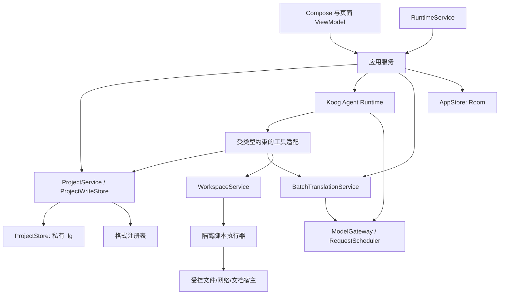

# 原生 LG 目标架构

这是拟实施设计，现状与授权见 [总入口](README.md)。功能验收以 [功能矩阵](FEATURE_MATRIX.md) 为准，实施依赖见 [任务计划](IMPLEMENTATION_PLAN.md)。

## 1. 架构选择与依赖

使用 Kotlin / Compose 原生应用。Koog 沿用 LNT 1.3.0 接入框架，在真实 Android 原型中核对依赖和 API；不以最新网站示例直接替换锁定版本。业务不依赖 Koog 的具体会话类型、Android ViewModel 或某一家模型 SDK。

`minSdk 24`、`targetSdk 36`、Java 17 为起始约束。现有 Jackson 排除只说明旧实现不用 Koog 检查点，不能原样保留后宣称新持久化可用。`R02` 比较自定义存储/序列化与必要依赖，验证 D8、最低 API 和恢复行为；若最低版本必须提高，先记录失去的设备范围与迁移影响，再更新全部构建和验收矩阵。

逻辑边界如下。`R01` 先建立 7 个 Gradle 模块，细分目录不等于要求立即建立十余个模块。

| 初始模块 | 内部职责 | 允许依赖 |
|---|---|---|
| `:app` | Application、Activity、Compose 页面/导航、应用装配、Service 声明 | 下列模块 |
| `:core:domain` | 值对象、命令/回执、状态、窄接口、纯业务规则 | Kotlin / 序列化基础 |
| `:core:engine` | 工程、翻译、校对、规则、模型调度应用服务 | domain |
| `:core:agent` | 保留改造的 Koog 框架、策略、工具适配、会话协调 | domain、Koog；通过端口调用 engine |
| `:core:storage` | SQLite `.lg`、Room 应用记录、文件、凭据、迁移适配 | domain、Android IO |
| `:core:formats` | 解析/写回注册表、文档/游戏引擎及输出宿主适配 | domain、受审查原生库 |
| `:core:workspace` | 脚本引擎、模块解析、能力桥和隔离执行端口 | domain、受审查脚本引擎 |

模块公开签名直接使用 domain 类型，因此 domain 依赖以 `api` 暴露，否则消费者拿不到 `RunIdentity`、`AgentMessage` 等类型。
engine 不直接依赖 storage/workspace 实现：跨模块能力经 domain 端口在 app 装配时注入，避免依赖环，也让原型测试能替换假实现。

模型网络传输先在 engine 的独立包中实现；隔离脚本 Service 由 app 装配，执行器不依赖 UI。WorkspaceService 的工程协调在 engine，脚本机制在 workspace，通过 domain 端口调用格式/文件能力，不让 workspace 与 formats 互相依赖。将来构建时间或依赖图证明需要时再拆模块。禁止 engine 依赖 app，禁止 Agent 工具通过 `AppViewModel` 执行业务，禁止 formats 自行开工程数据库连接。

## 2. 核心领域模型

| 对象 | 身份与职责 | 持久化位置 |
|---|---|---|
| `Project` | 工程身份、设置镜像、分区修订与资产集合 | 活动 `.lg` |
| `Asset` | 原始字节、类型、路径身份、排序；零条目文件也必须保留 | `.lg` |
| `Item` | `itemId`、源文/译文、姓名完整字段、状态、原始定位、格式私有数据 | `.lg` |
| `PDFDocument / PDFPage` | 原页身份及 `null / keep / omit / translate` 的不同决定 | `.lg` |
| `RuleSet / RuleEntry` | 术语、保护、译前、译后规则及启用/排序/修订 | `.lg`；预设在应用存储 |
| `PromptConfig` | 模板/用户覆盖/预设及版本冲突依据 | 工程与应用按 LG 归属分别保存 |
| `AgentChat` | 工程内产品对话、活动分支、消息身份和附件引用 | 可交换历史在工程；执行辅助状态在 AppStore |
| `AgentRun / InputCommand` | 回合、输入尝试、命令去重、配置快照和运行终态 | AppStore |
| `ApprovalRequest` | 固定差异、工程/会话身份、对象指纹、裁决和消费记录 | AppStore；提交回执关联工程 |
| `TranslationRun / RequestAttempt` | 本轮目标、进度、请求用量、恢复状态、取消来源 | 已提交事实在工程；运行审计在 AppStore |
| `Workspace` | sources、datasets、changes、work、uploads、reference、版本化工具文档 | 私有文件目录，身份关联 Project / Chat |
| `ModelConfig / Credential` | 协议、能力、阈值、用途和认证；密钥独立 | 应用配置 / 凭据存储 |

旧 `Book / Chapter / Segment / Edition` 不进入新业务模型；它们只出现在一次性旧数据读取器中。不要用“把每个字幕块叫 Segment”继续隐藏旧模型依赖。文件与 Item 身份稳定，导出不依赖列表序号或正文相等定位。

状态必须有唯一拥有者：

- 工程数据库拥有原稿、译文、修订与累计统计。
- Runtime 拥有当前工程、租约、活动回合和执行任务。
- 应用数据库拥有命令、审批、输入队列、执行回执与恢复索引。
- 页面 ViewModel 拥有筛选、滚动、选区、未提交草稿；跨页面草稿按 Project/Chat 身份进入独立草稿存储。
- 缓存只投影已提交事实；不得作为第二个工程数据库或从 UI 回写整个快照。

## 3. 存储与 `.lg` 兼容

### 3.1 选择

活动工程以应用私有目录中的 `.lg` 为工程事实。使用专用 SQLite 适配器遵守 LG 当前 schema 和迁移，不让 Room 接管外部 `.lg` 的 schema 身份。Room 只管理新应用记录；旧 Room v6 数据库独立保留为迁移源。

工程导入：SAF 字节流 → 暂存 → 结构/大小/压缩预算验证 → 私有活动副本 → 索引发布。导出：数据库一致快照 → 校验单文件 → SAF 写入 → 关闭流 → 回报交付结果。正在访问 WAL 的数据库不得直接复制主文件。

源文件可能来自云文档提供者，不假定存在真实路径，不直接在 SAF URI 上运行 SQLite。目录权限失效时保留私有工程并提供重新授权或另存。

### 3.2 兼容层次

| 层次 | 必须证明的内容 |
|---|---|
| 物理格式 | 表、字段、索引、JSON 表示、BLOB、Zstd 和单文件快照可读 |
| 业务事实 | 原稿、零条目资产、类型、顺序、稳定身份、全部状态、规则、提示词与修订一致 |
| 历史展示 | Pi SDK 分支、消息、工具调用/结果、摘要、附件引用可转换并回看 |
| 继续对话 | 转换后的活动分支与有效上下文能交给 Koog；旧执行标为中断，不重放副作用 |
| 双向交换 | Android 导出后 LG 能打开并继续业务；LG 再保存后 Android 能重新读取 |

不要求序列化 Koog 内存对象为 Pi SDK 检查点；必须实现可交换的产品历史。`R04` 形成 Pi 历史读写适配原型与正式扩展协议：保留未知 SDK 表原值，Android 新历史映射到经过验证的 Pi 存储结构；运行专属状态使用带版本的应用附属存储。不能只加私有表便宣称 LG 能读到新历史。

若目标 LG 版本不能接受扩展，仍提供已验证的兼容导出器；可恢复备份保留完整 Android 执行历史。用户界面明确两类交付差异，不丢弃历史后继续称“工程完整导出”。未解决双向历史映射前，完整兼容项保持未完成。

### 3.3 多存储提交

工程提交和 Room 回执不共享一个物理事务。用稳定 `commandId / changeId` 与工程内提交回执协调：

1. AppStore 写准备记录，包含目标工程、意图摘要与内容摘要。
2. 同一工程事务检查去重回执、分区修订/对象指纹，应用修改并保存提交回执。
3. 提交成功后更新缓存并发布带修订的变化。
4. AppStore 补记已提交结果；该步失败时重开从工程回执核对，不能重新提交。

缓存/通知失败属于“已经提交、需要重载”，不是普通写入失败。不要先发“完成”再等待数据库。

## 4. 唯一写入口、互斥与事件

`ProjectWriteStore` 处理 Item、PDF、规则、提示词、被动去重协调、修订与统计。手动编辑、Agent `workspace_apply` 和批量翻译走同一入口。工程打开/关闭/重置、技能修改、模型认证与任务启动的占用矩阵按 LG `RuntimeOperationGate` 逐项还原。

`RuntimeCoordinator` 同步预留工程与回合身份，成功预留后才启动协程；发送、切工程、切分支和 Stop 操作核对同一个执行实例。旧执行的 finally 只能释放自己的 lease，不得释放新执行。

短临界区顺序：

1. 协调器锁内核对身份、命令去重和占用并登记执行；立即释放锁。
2. 网络、等待用户、脚本和宿主请求在锁外执行。
3. 提交前取得允许的写租约，再进入工程短事务。
4. 实际请求、脚本与宿主收尾后结束执行并释放运行占用。

会话存储队列与工程事务有固定先后顺序；不得持数据库事务等待模型、审批或 UI。SDK 回调不能反向等待已经持有自己执行权的队列。用竞争测试证明顺序，而不是注释宣称“线程安全”。

应用服务发布不可变 `ProjectChange`、`RuntimeSnapshot` 和 `ChatSnapshot`；包含 Project/Chat/Run 身份与递增修订。UI 从中心 StateFlow 读取一致快照，命令回包只指向同一修订，不自行维护另一套列表。迟到结果按身份丢弃，内容刷新失败保留最后成功显示。

## 5. Koog 框架改造

保留代码范围见总入口。先新增 `AgentModelPort`、`AgentToolPort`、`AgentPersistencePort`、`AgentEventSink`，使 Koog 文件不再依赖旧 Entity、ViewModel、LlmClient 或书籍工具。

### 5.1 模型消息与工具

- 主路径保存 typed user / assistant / tool-call / tool-result，保留调用 ID、供应商关联、图片和需要回传的推理字段。
- `PromptExecutor` 将 Koog 消息适配新模型网关；不用“展平成 system+user”作为所有供应商的固定历史格式。
- 原生工具按 Schema 注册并统一窄化参数。字符串、JSON 数值和整数边界逐项验证，禁止先 `toInt()` 再检查。
- 文本协议仅用于确有 LG 支持需求、且该模型不支持原生工具的能力分支；配置与回执明确，不因任意 HTTP 400 就自动重放付费请求。
- 不保留“同一工具同一参数永远第二次拒绝”的粗糙熔断。只读查询可在数据变化后重复；有副作用操作靠调用身份和持久化回执去重，循环上限与预算单独控制。

### 5.2 对话、输入与分支

一个活动工程对应一个产品 Chat，历史可分支。持久化 `messageId / branchId / inputCommandId / inputAttemptId / runId`。修改历史改变后续模型上下文，不撤销已发生的工程写入。

队列状态区分 draft / queued / sending / accepted / paused / failed。传输或 UI 重试沿用命令身份；用户重新发送产生新的尝试。草稿只在真实入历史后消费，停止前未受理的输入退回草稿。`steer` 的接收点、插入位置及 Koog 可执行阶段由 R02 原型确定，不能把“等待本轮结束后排队”标为执行中引导。

### 5.3 压缩与恢复

产品公开时间线保留压缩前内容；模型上下文保存已提交摘要、切点及成对工具历史。预算按模型上下文、最大输出和压缩预留计算；累计消耗不随压缩减少。

检查点包含策略版本、节点/阶段、活动分支、模型快照、已受理输入、工具调用回执、摘要和运行状态。持久化数据可迁移，禁止保存不可序列化的 Coroutine、Bitmap 或打开的句柄。

恢复先核对工程副作用与模型回执。遇到“请求已发出但无结果”“工具可能已提交”等不确定状态，显示中断并要求明确继续，不自动重发。Koog 状态回滚不回滚已经提交的工程事实。

## 6. 审批与用户问题

`ask_user` 是普通问答；`ApprovalService` 才拥有写入授权。手动/自动偏好是持久化配置，当前审批展示后沿用原裁决，不因切换偏好自动通过。

准备变更时保存不可变 `PreparedChangeSet`：工程/会话身份、涉及对象、指纹、差异摘要和内容摘要。显示内容与最终提交使用同一个对象；提交前重新核对身份和冲突。`allow_once` 只能消费一次，不授权未来修改。

拒绝、取消、超时、断线、旋转、进程重启和工程切换都有明确终态。等待期间不持数据库锁；恢复审批不能绑定到新 Chat。前台不可操作时暂停自动选择计时。审批消费与工程提交通过稳定回执协调，避免批准后崩溃再次生效。

## 7. 可编程工作区与动态技能

### 7.1 执行模型

选择“嵌入 JavaScript 引擎 + Kotlin 能力桥”，不运行 Node 业务服务。QuickJS 是 R03 首个评估对象；若异步/模块/WASM/资源限制不满足，则评估其他 Android 嵌入引擎，记录包体、ABI、性能和维护成本再定型。支持脚本是完整版本门槛，不允许退化成有限按钮式 Agent。

脚本执行放隔离 Service 候选中，R03 验证 `isolatedProcess` 的可用 API、生命周期与加载边界。普通 `android:process` 只提供进程隔离，不构成文件权限边界。宿主仅传允许材料的只读描述符/受控句柄；大数据走文件描述符或流，不能塞入 Binder 大消息。

不暴露脚本引擎默认的任意文件、进程和网络 API。文件访问通过规范化路径、句柄与能力令牌；保护 sources、快照、内置技能和工程数据库。用户技能写入按真实目录权限校验。网络走同一代理策略和取消边界，回环请求保持直连。

执行有时间、内存、输出、图片数量和文件预算。取消/超时触发引擎中断，宿主请求和流收尾；未确认旧执行结束前不释放写入占用或允许下一执行接管。引擎不能中断的情况必须在原型中暴露，不以取消 UI 遮盖仍在运行的脚本。

### 7.2 能力兼容

| LG 能力 | 原生责任 |
|---|---|
| `ws.contract` / datasets / reference | 同一 Schema 生成校验器、Kotlin 类型、脚本声明与模型文档 |
| `node:fs/promises`、Buffer、路径、文本编码等已使用接口 | 建立明确兼容子集与测试；不声称完整 Node API |
| ZIP、表格、Markdown、编码、PDF、JS/Ruby 解析 | 锁定资源包；可移植 JS 在构建时打包，原生适配器补齐依赖 |
| `@lg/workspace` / `@lg/text` / `@lg/pdf` | 提供等价能力和版本化模块名/契约，复用新业务实现 |
| `emitImage` / `host(print_pdf)` / doing | Kotlin 图片、PDF 宿主与执行进度端口 |
| `workspace_apply` | 变更校验、指纹、审批和唯一工程写入口 |

R03 从 LG `package.json.workspacePackages`、实际部署目录和全部内置脚本生成兼容清单：逐个记录使用的导出/API、目标实现、样例、限制和证据。所有内置技能脚本必须可运行；用户脚本迁移说明必须准确。若现有声明承诺的 API 未覆盖，对应功能仍未完成，不把“引擎能跑加法”当工作区验收。

### 7.3 文件、技能与资源寿命

`sources` 随资产修订重建，`datasets/changes` 随快照刷新，`work/uploads` 跨回合保留，按 Chat 重置/数量清理；当前活动工作区受保护。已发送图片保持固定结果，不能因源文件变化改写历史。

技能包含元数据、`SKILL.md`、references、scripts 和其他资源。支持用户同名覆盖、启停、显式引用、显示顺序、资源树编辑与文件版本冲突检查。模型选择权限、列表显示与文件权限分别判定；隐藏不等于禁用。技能文件改动与 Agent 执行按 LG 互斥，执行收尾后刷新目录。

指令、类型声明和示例必须随真实宿主能力变化；不保留虚假的 Node/npm/Chromium 声明。测试使用自有技能包，不断言动态内置技能的具体名称、数量、顺序或正文。

## 8. 翻译与文本流水线

新 `BatchTranslationService` 独立于 Agent。UI 和 Agent 共享它；Agent 内调用借用当前合法运行租约，不另建竞争运行。

流水线：固化原稿 → 资格/语言/重复来源判定 → 文本保护/译前替换 → 同文件规划和 token 预算 → 前文/术语/提示词 → 模型请求 → 输出解析 → 文本恢复/译后替换 → 校对证据 → 同事务保存有效结果。

对齐 LG 的同文件去重、姓名字段、过滤跳过、语言、ruby、MTool 优化、空译文和错误条目语义。重试区分请求错误与内容错误；内容采用 LG 的对半切与逐条收敛，不能继续套用 LNT 的章节/META 协议。

调度统一管理请求额度、RPM/并发、密钥失效/冷却/恢复、Retry-After 与自动并发。全密钥不可用时按 LG 等待恢复或取消；不要把内容错误当认证故障。每次请求使用固定配置快照，设置变化供后续执行使用。

本轮进度、工程累计统计、工程完成率分别维护。取消保留有效提交，completion 等全部请求与宿主收尾。服务异常后标为 interrupted，不自动恢复可能计费的请求。

## 9. 模型、搜索与网络

新模型层覆盖 LG 的 OpenAI Chat、Responses、Google、Anthropic、SakuraLLM 及可配置兼容端点；思考等级 DEFAULT/OFF/LOW 等、服务档位、生成参数、上下文、最大输出、额外 headers/body、密钥池、用途选择和能力发现均有显式模型。

Koog 和翻译引擎消费同一能力/认证/用量事实。兼容参数与失败回退在协议适配器里处理，不散布到 UI，不因响应是 HTTP 200 就认定成功。OAuth 复刻 LG 已有登录、刷新、目录与模型测试边界；不把 API Key 输入当成 OAuth 完成。

分开记录输入、缓存读取/写入、思考、输出、费用与实际/估算/未知状态；供应商不回传时不伪造零成本。

搜索按基线：每次先尝试 DeepSeek Search；缺配置/请求失败转既有五家 MCP 备用，正常空结果不触发回退；Fetch 按当前 DeepSeek 能力。取消结束整条链，结果截断明确。MCP 采用 Android 可用的远端传输适配，桌面 stdio 示例不能当作可运行证据。

新凭据存储使用 Android 加密边界，日志和工具结果脱敏。代理失败不静默直连，重定向、认证回调和本地回环分别验证。来源正文作为外部资料进入模型，不能直接变成产品指令。

## 10. 文件格式与导出

`FormatRegistry` 通过内容和扩展名识别，提供 discovery / parse / regenerate / write / validate。源原始字节和格式定位先入工程，再允许翻译；写回只读取固化原稿。格式层不维护工程会话，不直接提交译文。

- TXT/Markdown：编码、换行、首尾空白、标记、姓名/正文与双语策略。
- EPUB：ZIP 安全、spine/nav/NCX、资源、图片、样式、章节身份与重新打包；保真与 LG 写回语义逐项比较。
- 字幕：时间轴、样式/说话人、ASS/SSA 非文本字段、VTT 标记和零条目文件。
- JSON/表格/TRANS：原始数值表示、结构/字段位置、工作表、单元格和非翻译数据。
- RenPy/MV/MZ：脚本 AST/字符串精确定位、引擎过滤、媒体/目录准备、加密与失败恢复。
- RGSS：归档/Marshal、Ruby 源码字符串定位、数据写回；原型必须覆盖服务级闭环，不能沿用 LG Termux 的验收空缺。
- PDF：原页提取、图像、文本/字体/坐标、页级决定、静态 HTML 排版、合并/省略和整份输出；Android 系统打印只作为交互适配，不能假设与 Chromium 版式相同。

具体库在 R05 实测后锁定；不得把 PdfRenderer 仅能显示页面当成完整 PDF 提取/写回能力。检查 native ABI、WASM 运行条件、字体、许可证适配与发行资源；未通过的库不能进入全格式实现排期。

导出 staging → 内容校验 → 发布 → 清理。源稿缺失、结构不匹配、部分写回失败都应报告具体文件/位置；不能生成遗漏译文的文件后报成功。格式结果验收用内容事实和结构，不强制 ZIP 时间戳等非语义字节相同。

## 11. Android 生命周期与存储

`RuntimeService` 管理应用级执行作用域；同进程 UI 通过应用服务/Flow 调用，不为复刻 Web 增加 HTTP/SSE。Service 存活不依赖 Activity 引用，关闭页面不取消已受理任务。前台通知提供运行进度、停止和返回入口；通知权限拒绝不能破坏数据恢复。

长任务根据真实用途声明前台服务类型并处理超时；后台启动限制、Doze、网络切换、低内存和强制停止纳入设备矩阵。WorkManager 只用于适合重新调度的维护/恢复提醒，不作为绕过系统时长或配额的手段，不自动重放模型付费操作。

Android 15+ 在相应目标版本下限制 dataSync/mediaProcessing 后台时长；Android 16 的长 Worker 也涉及 job 配额。用可恢复分批提交与用户主动继续满足长任务，而不是承诺无限保活。[前台服务超时](https://developer.android.com/develop/background-work/services/fgs/timeout)、[长 Worker](https://developer.android.com/develop/background-work/background-tasks/persistent/how-to/long-running)

文件 IO 分开限制输入字节、压缩展开、解析后内存、输出和并发。LG Web 的 64 文件/64 MiB/128 MiB 是浏览器暂存政策，不是新 Android 产品不经验证的永久硬编码上限。R06 在低内存设备上形成预算和大目录分批策略；实际占用包含在途工作，失败释放预算并保留可重试材料。

## 12. 旧 LNT 数据迁移与淘汰

1. 在升级前/首次启动用一致快照保护旧 Room v6 数据库与所有正文/插图/原稿文件，生成迁移清单和校验。
2. 每个旧 TranslationProject 建立新工程；多个 Edition 不强行挤成单一“当前译文”，分别形成可识别工程/资产和来源映射。
3. 原稿、译文、人工修订、词表、提示词、规则和来源关系转换；故事/章节 Memory 作为带来源材料保留，不再强制进入新翻译协议。
4. 旧阅读进度、书架排序、封面和额外 Edition 信息写入可导出的迁移档案；新产品不增加旧阅读器来消费它们。
5. 旧 Agent 会话保留原顺序和角色，迁移为可回看的历史；只有能无歧义建立工程归属的对话才能继续，否则作为应用历史档案打开并明确选择目标工程。
6. 模型配置和凭据通过旧读取适配器迁移到新端口；解密失败要求重新配置，不抹去旧密文，不把它当空密钥成功。
7. 迁移按工程 staging → 验证 → 发布 → 标记；可取消、可重入、可恢复，失败不改源库。
8. 旧数据在用户确认前不删除。通过迁移与升级验证后，删除旧运行时代码、页面、依赖、提示词与失效测试；仅保留必要旧数据读取器。

保留迁移读取器是保护用户数据的隔离边界，不代表保留旧产品主链路。应用 ID、签名与 versionCode 维持升级连续性；产品名称/图标的变化不自动改变包名。

## 13. 官方依据与适用边界

- [Koog Functional agents](https://docs.koog.ai/agents/functional-agents/)：策略/工具编排参考，具体 API 仍以锁定依赖为准。
- [Koog Persistence](https://docs.koog.ai/features/agent-persistence/)：检查点与工具副作用不同，需要应用协调。
- [Koog Providers](https://docs.koog.ai/llm-providers/)：框架支持能力不是全部 LG 供应商行为的证明。
- [QuickJS](https://bellard.org/quickjs/quickjs.html)：可嵌入、内存和中断接口；不提供完整 Node/npm 环境。
- [Android SAF](https://developer.android.com/training/data-storage/shared/documents-files)：URI 与文档提供者，不承诺真实本地路径。
- [Android Service](https://developer.android.com/reference/android/app/Service)：隔离执行与生命周期原型依据。

上述资料于 2026-10-22 查询。没有由此推断新增依赖已经编译、真机可用或格式输出已经一致。
