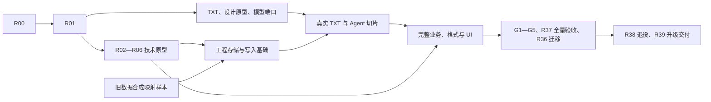

# 实施、依赖与验收计划

目标与授权见 [总入口](README.md)，业务范围见 [功能矩阵](FEATURE_MATRIX.md)。任务规格不表示当前进度；实际完成记录只写 [HANDOFF](HANDOFF.md)。

## 1. 实施原则

- 在 LNT 仓库中完成重构，Koog 框架按白名单迁移；旧 UI、书籍业务、翻译/模型实现不作为新主链路底座。
- 按可验收的业务切片推进，不先生成所有页面、空 Repository 和永远返回成功的工具。
- 高风险原型先于批量业务开发；原型通过仍需正式集成和回归。
- 每轮先核对脏文件；规划时的 22 个未提交文件属于历史基线，不能据此推断当前状态或覆盖当前修改。准备旧实现删除清单前，保存可重现源码和数据迁移输入。
- 按任务依赖独立推进，不要求每项再次确认普通实现细节。用户已授权实施；每轮实际范围、证据和未完成项只记入交接记录，任务表存在不等于自动扩大授权。外部写入/真实付费调用/发布按会话实际授权执行。
- 本机不运行 Gradle、测试、Lint 或 APK。静态核对、外部 CI/PC 验证、真机和供应商证据分别记录，不能互相替代。

## 2. 阶段与退出条件

| 阶段 | 任务 | 退出条件 |
|---|---|---|
| M0 基线与规则 | R00 | 固定 LG 工作区和 Koog 来源，规则与目标一致，夹具/接口索引可追踪 |
| M1 技术路径 | R01—R06 | G1—G5 全部有真实原型证据和书面依赖决策 |
| M2 工程与模型 | R07—R11、R14、R23；R30 原型 | 原生 .lnt 工程/资产/修订与模型可用，基本格式可写回，原生 UI 方向明确 |
| M3 核心业务 | R12—R19 | 手动与 Agent 共用翻译、校对、审批与恢复，假模型闭环成立 |
| M4 工作区与全格式 | R20—R29 | 技能/脚本、联网、文档/字幕/游戏格式逐项成立 |
| M5 全量原生 UI | R30—R35 | 全页面、系统文件交付、五语与实际视觉/交互验收 |
| M6 升级与交付 | R36—R39 | 旧数据迁移、98 项功能证据、旧主链路退役与签名升级验收 |

阶段是能力分组与退出条件，不是全局串行栅栏。R30 四页面原型、TXT 闭环和迁移字段样本可提前推进；只消费已验证的直接依赖。对应高风险能力未经验证，不扩展其调用者；G1—G5 未全部通过时 M1 保持未完成。M2/M3 的样例不是最终全格式验收。

## 3. 工作量与排期方法

下面的 S/M/L/XL 是风险与拆分粒度：S 为边界明确的独立改动，M 为单模块完整业务，L 为跨层切片，XL 为需要多个子项与外部依赖验证的工程。不是已经测量的工期。

按已验证子产物滚动估算下一切片的工作量和设备窗口；完整版本总工期须等待 M1 的真实依赖加载、格式和兼容结果。不能在尚未解决脚本/PDF/RGSS 时给出确定的完整上线日期。

实施分流如下；节点表示子产物或验收集合，不表示所有任务整项完成后才可开始下一项：



开工前置以下表及 §4.1 为准。限定为“基础/原型”的前置只放行相应切片；所有子产物与完整验收均完成后才能关闭整个任务，不能把开工资格记成任务完成。R31—R35 的表列前置用于完整页面验收，最小真实界面按 §4.2 提前接入。

## 4. 任务总表

| ID | 任务 | 前置（范围见 §4.1） | 粒度 | 主要产物 |
|---|---|---|---|---|
| R00 | 固定基线、规则与行为索引 | 无 | M | 工作区快照、功能细目、迁移来源清单 |
| R01 | 新模块与装配骨架 | R00 | M | 七模块边界、依赖锁、CI 检查入口 |
| R02 | Koog 保留层原型（G1） | R01 | XL | typed tools、暂停/恢复、序列化与 Android 证据 |
| R03 | 脚本/隔离/包兼容原型（G2） | R01 | XL | 引擎决策、能力桥、兼容 API 清单 |
| R04 | .lnt 存储基础与 .lg/Pi 双向兼容原型（G3） | R01 | XL | 原生 SQLite/版本迁移、LG Zstd/历史转换和回灌证据 |
| R05 | PDF/EPUB/游戏格式原型（G4） | R01 | XL | 底层库决策、最小完整写回与视觉 |
| R06 | Service/SAF/预算原型（G5） | R01 | L | 生命周期、设备预算和取消回收证据 |
| R07 | 新领域/ProjectStore/AppStore | R04 存储基础 | L | schema、迁移、类型和读写端口 |
| R08 | 唯一写入口/运行占用/事件 | R07 存储基础 | XL | 事务、冲突、命令回执、一致快照 |
| R09 | 工程生命周期与资产流程 | R08 写入基础、R23 解析写回基础 | L | 创建、打开、追加、重置、设置对齐 |
| R10 | 模型配置、协议、目录、认证 | R01 | XL | 全协议适配、OAuth 与能力目录 |
| R11 | 请求调度、密钥、用量与网络 | R10 单协议基础 | L | Scheduler、UsageLedger、代理与错误策略 |
| R12 | 文本、规划、去重和输出协议 | R08 写入基础、R11 请求基础、R14 规则基础 | XL | LG 对齐纯业务流水线和黄金夹具 |
| R13 | 批量翻译与任务恢复 | R06 生命周期基础、R12 TXT 流水线 | XL | 三种启动模式、分批提交和 completion |
| R14 | 规则、提示词、预设与交换 | R08 写入基础 | L | 四类规则、版本冲突、预览导入/导出 |
| R15 | 校对查询、编辑与统计 | R08 写入基础、R12 TXT 流水线、R14 规则基础 | L | 稳定查询窗口、批操作和六类警告 |
| R16 | Koog 正式集成与业务工具 | R02、R08 写入基础、R10 单协议基础、R11 请求基础 | L | 新 ToolPort、Schema、实际业务回执 |
| R17 | Chat/输入/分支与执行协调 | R07 存储基础、R16 只读接线 | XL | 命令去重、队列、steer、历史编辑 |
| R18 | 压缩、检查点与不确定恢复 | R17 身份与持久化基础 | XL | 持久摘要、版本化恢复与用量 |
| R19 | 用户问题与审批执行层 | R08 写入基础、R17 身份与持久化基础 | L | 固定差异、裁决、单次消费和恢复 |
| R20 | 工作区正式集成与产物 | R03 执行原型、R09、R19 | XL | 快照、脚本、changes、IO 与保存 |
| R21 | 动态技能、人格与运行文档 | R20 | L | 资源加载/覆盖/编辑、真实执行指令 |
| R22 | 搜索、Fetch 与 MCP 备用 | R10、R16 | M | DeepSeek 优先链与取消/失败回退 |
| R23 | TXT/Markdown | R01 | M | 编码、结构、定位及译文/双语写回 |
| R24 | EPUB | R05、R09 | L | 完整容器/资源/目录与写回 |
| R25 | 全字幕格式 | R05、R09 | M | SRT/VTT/LRC/ASS/SSA 读写 |
| R26 | JSON/表格/TRANS/RenPy | R05、R09 | XL | 四类适配器及各自结构闭环 |
| R27 | RPG Maker MV/MZ | R05、R26 | XL | 准备、定位、媒体/加密与写回恢复 |
| R28 | RPG Maker RGSS | R05、R09 | XL | 归档/Marshal/Ruby 的服务级闭环 |
| R29 | PDF 与图片宿主 | R05、R09、R20 | XL | 提取、页处置、排版、预览与输出 |
| R30 | 原生设计系统与工程导航 | R00、R01 | L | tokens、路由、四页面视觉原型 |
| R31 | Agent 全流程 UI | R17、R18、R19、R20、R30 | L | 对话、资料、队列、审批与历史 |
| R32 | 工作台与完整校对 UI | R13、R15、R30 | L | 表格、筛选、批量编辑和译文交付 |
| R33 | 规则/提示词/技能 UI | R14、R21、R30 | L | 编辑器、预设、文件树与冲突恢复 |
| R34 | 模型/设置/日志 UI | R10、R11、R22、R30 | L | 全字段接线、诊断与国际化 |
| R35 | 存储、SAF、分享与备份恢复 | R06、R09、R20 | L | 系统交付、清理、权限恢复和一致副本 |
| R36 | 旧 LNT 数据迁移 | R00（字段样本）；正式迁移需 R07、R09、R17、R35 | XL | 可恢复迁移器、档案和升级入口 |
| R37 | 全功能/差异/设备回归 | R13、R15、R18、R19、R21、R22、R24、R25、R26、R27、R28、R29、R31、R32、R33、R34、R35、R36 | XL | 每项功能证据、全格式/后台/视觉矩阵 |
| R38 | 退役旧产品与文档收口 | R36、R37 | M | 删除旧主链路、资源和依赖，维护权威入口 |
| R39 | 签名升级与最终验收 | R37、R38 | L | 可安装升级产物、验收报告和发布说明 |

### 4.1 子产物与完整验收的区别

以下均为既有任务的子产物，不增加或关闭任务 ID。基础产物进入正式模块，由原任务持续拥有；假模型和合成夹具只用于验证，生产链路不得注入假存储或假审批。每份证据记录源码提交、夹具、构建/设备身份、结果及未覆盖范围；失败阻塞其消费者和完整验收。

| 子产物 | 最小内容与放行范围 | 整项关闭前还需 |
|---|---|---|
| R01 装配基础 | 七模块、依赖边、独立装配入口可编译/安装 | 依赖锁与模块边界；SDK/native 具体能力归 R02—R06，避免反向等待 |
| R02 Koog 原型 | 两个 typed tool、受控问答/审批、检查点、steer；合成对象的真实本地持久记录与提交回执 | Android 生命周期与恢复证据；正式工程集成另由 R08/R19/R16 验证 |
| R03 执行原型 | API 分类清单、代表脚本、受控 IO、宿主取消与资源限制；changes 可验证但不写用户工程 | R20 接通 R19/R08 后的工程审批提交、代表材料和包兼容证据 |
| R04 存储基础 | 原生 `.lnt` SQLite、格式标识/版本迁移、身份/副本规则、文本资产、修订与一致快照 | `.lg` 的 Zstd/字段转换、Pi 双向历史、全部兼容夹具与 LG 双向回灌；之前禁止宣称完整兼容 |
| R06 生命周期基础 | 活动执行/等待/中断的持久状态、停止与收尾、SAF 最小保存和重启核对 | 脚本/PDF/native 接入后的设备预算与全部系统干扰矩阵 |
| R07/R08 存储与写入基础 | 合成旧库字段映射评审；真实 ProjectStore/AppStore、身份代际、命令绑定与事务回执 | 全对象、分区、部分冲突、跨库故障与恢复矩阵 |
| R09 TXT 生命周期 | TXT 建工程、私有原稿固化、打开/关闭与重开，不依赖未完成格式 | 全资产追加/删除/重排、重置、设置对齐、复制与来源冲突 |
| R10/R11 单协议与请求基础 | 一个明确协议的真实适配器对假服务；配置快照、统一调度、取消与用量回执 | 五类协议、OAuth、完整配置、密钥池与故障矩阵；Koog 接线由 R16 证明 |
| R14/R12/R13 TXT 基础 | TXT 所用规则/提示词、规划/协议、分批提交与持久停止；未实现选项不得展示可用 | 完整规则交换、全部翻译模式、格式差异与压力恢复 |
| R15 最小编辑 | TXT 原译条目读取、稳定身份、手工编辑与冲突回执，供 S1 校对 | 完整筛选/窗口/统计、批量操作、六类警告与 PDF 页级事实 |
| R16/R17 只读接线 | Koog 经统一网关、真实工程只读工具、Chat/Run/输入命令的持久身份 | R19 就绪后开放写工具；R13 就绪后接批翻，再验队列/分支/全部工具 |
| R18 回执恢复基础 | S2 所用检查点、请求不确定状态、审批命令回执的重启核对，不自动重发 | 全部分支、压缩摘要/切点、用量和版本迁移矩阵 |
| R23 解析写回基础 | TXT/Markdown 纯格式读写与定位，可供 R09 导入使用 | R09/R13 接通后的工程导入、翻译、导出、重读；不反向阻止 R09 开工 |
| R36 迁移字段样本 | R00 后用合成旧库建立字段/档案映射，在 R07 schema 冻结前评审 | 正式迁移、系统交付和升级恢复仍依赖任务表列出的后期产物 |

R05 的 EPUB、PDF、MV/MZ、RGSS 分别记录证据；对应原型通过即可开始对应适配器，不以某一格式通过代替 G4 全部通过。字幕、表格等未被代表原型覆盖的依赖，在各自任务内先验证再推广。任务表中 R05 前置按此对应能力解释。

### 4.2 早期真实业务切片

| 切片 | 依赖的已验证子产物 | 必须实际跑通的结果 |
|---|---|---|
| S1 手动 TXT | R04/R07/R08 存储写入基础、R09 TXT 生命周期、R10/R11 请求基础、R12/R13/R14 TXT 基础、R15 最小编辑、R23 解析写回基础、R06 生命周期基础；R30 与 R32/R34/R35 最小界面 | 创建 `.lnt` 工程 → 假模型翻译 → 手工校对 → SAF 保存 `.lnt` → 重开；真实 SQLite/文件/服务，核对取消和失败后事实 |
| S2 Agent 审批写入 | S1、R02、R16/R17 基础、R19 持久审批提交、R18 对应恢复路径；R31 最小界面 | Agent 查询 → 固定差异 → 允许一次 → 提交 → 重启核对；拒绝、重复提交、消费后崩溃均可解释 |
| S3 工作区与复杂格式 | S2、对应 R03/R05 原型、R20 及对应格式任务 | 脚本真实材料 → changes → 工程审批提交 → 产物保存；逐步扩展全部格式/技能 |

R30 假数据视觉原型只确定组件，不构成 S1/S2。R31—R35 可按切片交付最小真实界面，未满足全部前置时不得关闭任务。S1/S2 是阶段证据，不减少 98 项最终功能或跳过 G1—G5。

## 5. M0—M1：基线与五个门槛

### R00 固定源码与规则

保存两仓库提交与工作区差异、关键资源、依赖锁和文件清单，保证后续能重建同一基线。源码快照不得包含用户工程、模型密钥、日志正文或签名文件。当前 JSON 指纹作为漂移检测，不能代替快照。

核对新 AGENTS 与用户目标、保留 Koog 白名单、旧实现删除范围。补充可见操作、API 路由、设置字段、格式和工作区 API 清单；为所有细项绑定矩阵 ID。旧源码只读参照，不顺手修 LG。

验收：随机按功能 ID 追到 LG 实际入口和测试；两个工作区均可定位未提交内容；新用户说明明确处于重构期，不假称功能已经替换。

### R01 模块与资源装配

建立架构文档定义的七模块与统一构建配置；迁入 Koog 框架前编译并安装独立最小装配入口，确认 Kotlin/Java/Compose 和模块依赖。Koog 元数据/序列化及各 native ABI 在 R02/R03/R05 导入实际依赖时验证，不作为 R01 的反向依赖。依赖走 version catalog；不复用旧全局 ViewModel 装配。

将假模型、测试数据、产品资源与真实凭据配置分开。保留现有应用签名和升级身份；暂时共存的旧入口只用于迁移开发，不作为最终兼容产品。

验收：PC/CI 的最小编译、模块依赖检查、依赖锁定和最小装配入口安装；后续导入 SDK 时继续回归装配。不为过绿关闭受影响源码或 Lint。R01 不承担 G1—G5 的完整业务验收。

### R02 Koog（G1）

原型至少完成：流式多轮、两个 typed tool、一次问答、固定差异审批、工具中断、持久化检查点、Activity 重建/进程重启继续、压缩摘要保存和 steer 的实际插入。

使用合成对象和真实本地持久记录，不等待完整工程 schema 或全量 R19。持久接口与恢复夹具交由 R07/R08/R19 承接，原型不得成为第二套生产写入口；不能仅以内存 fake 证明进程重启恢复。

核对 Koog 1.3.0 的 functional strategy、PromptExecutor、typed history、存储/序列化和中断边界；对比旧 Jackson 排除。检查点恢复后先读取副作用回执，不自动重发。用假模型测原生工具与明确文本兜底各一路。

验收：最低 API 与主流 API 实际运行，恢复输出/副作用次数可核对；必须有 Android 打包和设备证据，不能以 JVM 单测替代。结论写明保留哪些 Koog 文件、重写哪些适配；必要的框架升级另作明确决策。

### R03 工作区（G2）

先固定 LG 预装包、脚本和实际 API 清单，按 ARCHITECTURE §7.2 分类后再选引擎。验证 ESM、Promise、Unicode/大整数、模块解析、文件/网络桥、ZIP/表格/文档桥、日志、图片、内存限制和中断；不能由 JS 语法支持推断 Node 包、WASM 或 native 绑定可用。

隔离 Service 用受控描述符传材料，验证大数据不会越 Binder 预算。执行越权读取/写入、链接逃逸、无限循环、取消时宿主请求、超量输出和引擎崩溃样例。正常包不能借兼容模块访问原生系统。

执行原型验收：合成原稿 → 脚本分析 → 生成并验证 changes，分别证明脚本中断、宿主请求取消和 native 退出。XLSX/EPUB/PDF 代表处理按实际包/宿主取证。真实工程“审批 → 提交”在 R20 接通 R19/R08 后补齐，之前只登记执行原型通过、G2 集成未完成；不提前另造生产审批/写入口。未覆盖包/API 保持缺口，候选失败形成替代方案，不删功能验收。

### R04 原生存储与工程兼容（G3）

原生工程格式已定为 `.lnt`，先验证独立 SQLite schema 的格式标识、版本迁移、保存与重开。另建立至少三代 LG `.lg` schema 夹具，包含文本、PDF、零条目资产、Zstd、规则、分支和工具历史；验证兼容层的 SQLite/Zstd 读取、`.lg`→`.lnt` 转换和 `.lnt`→`.lg` 导出，再验证新增提交、复制与双向打开。

先交付 §4.1 的存储基础，再做 Pi→产品历史→Koog 与 Koog→LG 可读历史映射；需要 Koog 运行证明时消费 R02 原型。按 ARCHITECTURE §3.4—3.6 验证身份、恢复代际、交换/备份范围与字段级历史映射。保存未知表/字段并比较语义；禁止破坏旧 SDK 数据。对源版本不支持的状态明确映射，不能随意删除表重建。

验收：LG→Android 修改→LG 再修改→Android，核对资产、状态、修订和历史；工程副本在 WAL 活动时仍一致。形成兼容版本表、原生/交换字段映射和完整备份封装决策；原生 `.lnt` 与兼容 `.lg` 扩展名不再列为未决项。

### R05 复杂格式（G4）

分别建立以下原型，库选择在通过后锁定：

- EPUB：复杂 nav/NCX、嵌套资源、图片、样式、ruby，修改后重新打包读取。
- PDF：文本/字体/坐标/图片提取，原页保留/省略/译稿排版与合并；查看实际 PDF 页面。
- MV/MZ：JSON/JS 字符串定位、目录/容器准备、导出与重解析。
- RGSS：最小合法归档、Marshal 数据、Ruby 字符串改写与重新读取。

验收：各有可交付文件和内容/结构核对；native/WASM 的 ABI、Android 兼容、许可证与资源包有明确方案。不能只“找到一个库”就开始全量写调用者。

### R06 Android（G5）

建立 RuntimeService 和 SAF 原型：Activity 离开/旋转、后台、锁屏、进程回收、强停重开、通知拒绝、网络切换、前台服务超时、空间不足和 URI 权限撤销。

先按 ARCHITECTURE §11 的阶段表验证“活动执行 → 持久等待 → 释放资源 → 用户恢复”，区分逻辑占用与进程内 lease。覆盖等待审批一夜、密钥不可用、超时收尾和旧执行迟到回包；可缩短测试阈值注入超时，不把短压测当作后台时长证明。

使用自有大样例测量输入、展开、解析、脚本、PDF 和并发的峰值内存/临时空间；明确 4GB 级代表设备及较高内存设备预算，不机械沿用 Web 上传上限。冻结工程规模、文件/展开预算、并发和图片处理策略。

验收：有设备/API/构建身份、RSS/PSS/存储口径和实际结果；已提交事实可恢复，取消无在途写入者。把阈值写入配置与后续压力夹具，未经测量的目标不登记为性能结果。

## 6. M2—M3：新业务核心

### R07—R09 工程与事务

R07 定义完整 Item/PDF/规则/提示词数据模型、原生 `.lnt` ProjectStore、AppStore、独立 schema 版本/迁移和查询投影；`.lg` 读写通过 CompatibilityStore 转换，不把 LG schema 直接作为原生 schema 权威。拒绝以旧 Edition 字段改名冒充新模型；工程数据库与运行索引有清楚的所有权。

schema 冻结前消费 R36 合成旧库映射样本，确认多 Edition、人工修订、缺文件、无明确工程归属的会话均有目标或档案位置；同时固定本地实例/恢复代际和备份清单。此时不读取或迁移用户真实数据。

R08 实现运行占用、ProjectWriteStore、分区修订、对象指纹、commandId 去重与提交回执。覆盖冲突对象部分接受、数据库整批回滚、DB 已提交但缓存/通知/Room 失败的不同结果。发送、切工程、Stop 和迟到 finally 共用身份协调器。

审批写入必须满足 APPROVAL_CONTRACT §5 的不可变正文、消费与命令原子绑定、同命令恢复和部分冲突规则；只有 CAS 消费成功不足以开放生产写工具。

R09 接通创建/打开/关闭、追加、删除/重排、原稿重置、设置对齐、最近工程与复制。解析和准备在提交前完成，上传/导入材料只在成功提交后释放。

验收：无 UI 假模型服务级闭环；进程崩溃插在每个写入阶段仍能按回执恢复；原文件删除后仍能从工程导出；错误明确到文件/对象。

### R10—R11 模型与请求

R10 按协议分别完成 Chat、Responses、Google、Anthropic、SakuraLLM；先以本地协议服务覆盖流式/非流式、工具、推理字段、图片、目录与错误。再实现模型预设/复制/排序、用途选择、能力与 OAuth。

R11 实现模型网关、密钥池、RPM/并发/自动探测、Retry-After、代理与统一用量。每个请求有配置快照、attemptId 和 usage 来源；取消在模型适配、退避、流解析和工具层贯通。

验收：协议矩阵、401/429/5xx/断流/取消、多个密钥全部失效后恢复；Agent/翻译/测试共用额度；日志中无凭据。真实供应商样例只在用户明确授权后执行并设请求/费用上限。

### R12—R15 翻译、规则与校对

R14 先实现四类规则、提示词、预设和导入预览的完整服务，再由 R12 引用。资源预设与模型历史不是数据库事实；跨存储改动记录补偿。

R12 用 LG 黄金输入/输出逐项实现过滤、语言、同文件去重、保护/替换、术语匹配、前文、token/行数规划、姓名与 JSONLINE 解析、内容重试和译后恢复。正则以真实 Android 行为验收。

R13 实现 new/continue/reset、请求调度、分批提交、用户停止、stopping/收尾、completion、累计统计与恢复。有效结果不能因后续批次失败回滚；不确定请求不自动重新计费。

R15 实现校对稳定窗口、搜索/筛选/警告/术语统计、手动与批量操作、清空和替换预览；PDF 使用页级事实。界面还没完成时也必须有完整应用服务行为测试。

验收：同一份合成工程通过手动命令与 Agent 调用获得同样事实；重复/错误/过滤状态和修订一致；六类警告有可定位证据，不以“没有警告”判定正确翻译。

### R16—R19 Agent 产品语义

R16 正式移入保留的 Koog 框架，替换所有旧 Entity/网关/工具依赖。工具描述、Schema、校验、权限和实际回执同源；数字整数性/范围必须在转换前校验。

先接统一网关与真实工程只读工具，供 R17 建立身份/命令基础；R19 持久审批提交就绪后开放对应写工具，R13 就绪后接批翻工具。R16 全部验收仍包含后续接线，不能用只读切片代替全部业务工具。

R17 实现 Chat、活动分支、命令/输入尝试身份、队列草稿、steer 和历史编辑。运行预留与切会话在同一协调器原子完成；每个迟到响应核对 Project/Chat/Run。

R18 保存有效压缩摘要、切点、成对工具历史、版本化检查点和累计用量。公开历史不被压缩抹掉；恢复请求/执行/提交的不确定窗口，核对业务副作用后再继续。

R19 实现普通问答与审批分离、PreparedChangeSet、差异摘要、单次批准/拒绝、超时与恢复。UI 不存在时请求仍有真实状态；审批偏好修改不回溯批准已展示请求。

验收：重复输入/编辑/切工程/Stop/进程死亡/审批消费竞争全部覆盖；模型未先询问时也无法绕过手动审批；修改历史不回滚工程事实；同一提交/工具身份无重复副作用。

## 7. M4：工作区与全部格式

### R20—R22 工作区、技能和联网

R20 将原型接入真实工程快照、sources/datasets/changes/reference/work/uploads。文件 ID、预算、输出、脚本失败日志和来源归属形成完整契约；workspace_apply 走 R19/R08，不能直接写数据库。

R21 将固定基线中的内置技能逐包迁移到新运行环境，补齐脚本/模块适配与模型文档；实现用户覆盖、文件树、启停/隐藏/显式引用、排序、人格与版本冲突。动态包机制用测试自有资源覆盖。

R22 实现搜索首选、五家备用、Fetch、MCP 传输、取消与结果预算。假 HTTP/MCP 服务覆盖正常空结果、单家失败、逐家超时、全部失败和用户取消；不调用真实搜索作为普通回归。

验收：用 Agent 完成术语调查、规则准备、材料分析、工程差异提交及产物保存的真实工具链；每个内置脚本有其实际用途证据。

### R23—R29 格式任务的共同子项

每个格式任务必须包含：发现/识别 → 原稿与定位 → 导入/追加 → 过滤与翻译 → 状态/重置 → 单语/双语或其真实适用输出 → 导出校验 → 重新导入 → 取消/失败恢复。不能只实现 reader。

| 任务 | 必须单独完成的子项 |
|---|---|
| R23 | TXT 多编码/换行；Markdown 结构和代码边界；空文件与同文双语去重 |
| R24 | EPUB nav/NCX/spine、资源/样式、图片、ruby、原容器写回与双语 |
| R25 | SRT、VTT、LRC、ASS、SSA 各自夹具；样式/时间/说话人不损 |
| R26 | KVJSON/MESSAGEJSON；XLSX/WOLFXLSX；TRANS/WOLF TRANS；RenPy 分别验收，不共用一个“JSON 成功”结论 |
| R27 | MV/MZ 目录/容器准备、JS/JSON、媒体/加密、原稿基线、失败回滚/人工恢复 |
| R28 | RGSS 归档、Marshal、Ruby AST/源码定位、写回覆盖与服务级回灌 |
| R29 | PDF 原页提取与缓存、页处置、模板/字体、图片、连续排版、页面合并、实际输出视觉和资源回收 |

RGSS 不能以“夹具难做”长期标为无需验收。PDF 不能以系统打印 Intent 被启动当成输出成功。游戏格式最终可增加目标平台运行验证，但不要求 Android 内置 Windows 执行环境。

## 8. M5：UI 与系统交付

R30 从 LG 视觉和当前工作流提取 Compose tokens/组件，完成工程首页、Agent、校对与模型编辑四个代表原型，实际查看截图后确认；路由和设计 token 一处定义。

R31 完成 U02 与问答/审批/资料/队列/历史；R32 完成 U03/U04；R33 完成 U05—U09；R34 完成 U10—U14；R35 完成 U15 与全应用文件/分享/存储。U01 由 R30/R09 集成。全部新 UI 使用 Android 资源五语，不复制旧书架 UI。

页面必须消费真实应用服务；开发用假数据不得遗留为上线链路。每项菜单、开关、筛选和导入导出都要追到消费者，只有按钮存在不算完成。

R35 除界面还负责流式保存、目录递归交付、URI 权限恢复、预算清理、手动副本/升级备份与恢复。保存失败保留源产物；数据根或输出目标切换采用 staging/验证/发布/清理。

单文件保存适配从 R06 基础承接，提前供 S1 使用；完整备份按 ARCHITECTURE §3.5 包含可核对清单与一致切点，恢复不继承旧执行授权。

验收按 UI_SPEC 的 15 个页面/系统界面、深浅色、五语、手机/平板、多窗口、IME、字体放大、TalkBack 和触屏替代操作执行。截图后实际看图，并记录真机与自动截图各自边界。

## 9. M6：迁移、退役和发布

### R36 旧 LNT 数据

字段样本在 R00 后提前开始，使用合成 Room 多版本、多 Edition/修订、缺原稿和归属不明会话；形成“源字段 → 新事实/档案 → 校验方式”映射，在 R07 schema 冻结前评审。无法表达的资料先修正目标模型，不留到最终迁移时丢弃。以下正式迁移与升级验收仍依赖 R07/R09/R17/R35。

迁移前生成源库/文件一致副本；读取旧 schema、Book/Edition/Revision/词表/提示词/规则/模型/Agent 会话。每个旧项目形成新工程，多 Edition 独立映射，旧阅读信息作为档案保留。

支持首次安装、旧库不同版本、同名、缺正文/图片、密钥无法解密、空间不足、取消、重启继续和重复启动。失败只影响当前 staging；迁移日志有对象级结果，不能因一项失败删掉原书。

验收：源库/源文件 hash 不变，目标数量/内容/来源映射可核对，旧历史可回看，用户能导出迁移档案。产品功能淘汰不等于用户资料淘汰。

### R37 全量验证

把每个功能 ID 的生产入口、PC/CI 测试、设备记录和产物链接写入交接。对照版本固定，差异必须注明语义差异/Android 等价交互/已知缺陷，不能把未验证写成等价。

至少完成一次完整流程：文件/目录建工程 → Agent 调查并生成规则 → 审批 → 批翻 → 校对 → 产物保存 → .lnt 保存/重开 → .lg 双向兼容交换 → 重启继续；随后对每类格式执行独立闭环。

### R38 旧实现清理

按“新消费者已接线 + 数据迁移已验 + 引用归零”删除旧 ViewModel、书架/阅读器、Book/Edition 主业务、旧引擎/协议、UI 字典、提示词、无关 ML Kit 和其他失去用途的依赖。

保留 Koog 白名单、必要旧数据读取器、历史源码/文档和用户数据。重写 README/AGENTS 代码地图，标识旧计划历史地位；长期架构/开发操作分别归并，不保留多个自称当前进度的文档。

验收：新主链路不再导入旧业务类型；旧入口不再启动；仅迁移模块能读取旧 Entity；实际依赖解析和资源扫描无残留。不能删除失败测试来掩盖仍在承诺的功能。

### R39 交付

PC/授权 CI 完成测试、Lint、Release 与签名校验；设备完成首次安装/覆盖升级/迁移失败恢复/兼容备份回退。versionCode 必须满足升级，不能仅依赖错误的跨分支 CI 编号假设。

完整验收报告列明 98 项分组及其补充细项、支持格式/供应商、设备/API、预算和限制。发布说明如实区分“已验证”“受能力限制”“未完成”。任何最终范围项未完成时只能交付阶段版本。

本计划不创建 Tag、不发布 Release、不上传私有数据。是否发布由用户实际授权决定。

## 10. 验证设计

### 10.1 分层证据

| 层级 | 内容 | 可证明 / 不可替代 |
|---|---|---|
| 静态 | diff、引用、Schema、路由/字段消费者、资源、文档链接 | 结构与文本一致；不证明编译和运行 |
| 纯逻辑 | 文本、规划、冲突、状态机、参数、格式单元 | 业务边界；不证明 Android IO/native |
| 服务集成 | 真实 SQLite/文件/假 HTTP/MCP/假模型、提交故障注入 | 工程一致性与业务闭环；不证明供应商真实行为 |
| PC/CI Android | 编译、Robolectric、Lint、APK、签名与资源 | Android 构建；不证明真机正则/IME/后台 |
| 设备 | SAF、Service、native、锁屏、字体、TalkBack、视觉 | 系统和设备边界；不代表所有厂商 |
| 有界真实供应商 | 明确授权后的协议/认证/搜索样例 | 指定供应商/配置；不替代假服务故障矩阵 |

现有构建命令只在 PC/CI 使用；多模块建立后将任务路径随实际配置更新：

```sh
./gradlew testDebugUnitTest lintDebug assembleDebug
./gradlew assembleRelease
```

设备测试按实际设备环境执行对应 connected task。不能在本机 Termux 运行这些命令，也不能用单文件 Kotlin 编译冒充模块通过。

### 10.2 夹具

夹具使用合成/项目可再分发材料，不读取用户完整小说作为回归数据。固定模型输出，分别验证黄金确定性行为与模型结果质量。

| 夹具集 | 内容 |
|---|---|
| 工程 | `.lnt` 版本/迁移/重开、`.lg` 多历史版本与双向转换、零条目、重复/姓名/空译文、规则/提示词/未知表/Pi 分支 |
| 格式 | 每格式正常/边界/损坏/取消/大数据；ZIP 路径、展开预算、资源缺失 |
| 对话 | 成对工具、多分支、压缩、附件、输入队列、问答和审批 |
| 网络 | 流式分片、断流、401/429/5xx、Retry-After、代理失败、取消 |
| 迁移 | Room 多版本、多 Edition、修订、缺文件、密钥失败和断点 |
| 规模 | 10 万 Item 查询、1.2 万条批翻、长对话、嵌套目录；预算以 R06 固定值执行 |

### 10.3 必测故障窗口

- 命令已受理但 UI 未收到结果；模型已请求但无完整响应。
- 工具已准备/已批准/正在提交/数据库已提交/通知失败。
- 格式已解析但原稿未发布；导出已写临时文件但未发布；SAF 关闭失败。
- 脚本运行中超时、宿主图片/PDF 请求未结束、旧执行迟到回包。
- 工程切换与发送、队列草稿编辑与旧回执、Stop 与下一轮预留。
- 缓存/Room 写失败、空间不足、URI 权限失效、压缩展开超预算。
- native 宿主崩溃、进程死亡、强制停止和再次启动。

每个窗口记录数据库/文件最终事实、是否重发请求、是否遗留执行者、是否可继续。测试只断言真实业务契约，不锁定动态技能内容或实现调用次数。

### 10.4 长任务与性能

至少做 30 分钟合成工作流，覆盖约 1.2 万条翻译、后台/锁屏/重连/取消和恢复；内容逐条核对。Agent 长任务另测，不能用批量引擎长任务替代。

记录设备、API、build、输入规模、耗时、峰值 PSS/RSS、临时空间、主线程阻塞和列表/流式 jank。R06 建立并冻结最低设备的验收预算，后续改变必须解释；未测量不得声称“更快/更省内存”。

## 11. 风险台账

| 风险 | 解决入口 | 停止扩展的信号 |
|---|---|---|
| Koog 序列化/minSdk 与依赖排除冲突 | R02 | 只有 JVM 通过或恢复丢关键状态 |
| 脚本引擎无法提供模块/取消/权限 | R03 | 必须给任意原生 IO 才能运行，或无法停止 |
| Pi 历史与新 Chat 双向兼容不成立 | R04 | 回灌丢分支、工具配对或新历史 |
| PDF 版式/提取和原生库资源过重 | R05/R29 | 只能显示或只能发打印 Intent，无真实输出 |
| RGSS/游戏准备破坏源码结构 | R05/R27/R28 | 没有重读定位/结构证据 |
| 数据跨库提交出现重复副作用 | R08/R18/R19 | 重试绕过工程回执、批准可被重复消费 |
| Android 后台限制与大文件内存 | R06/R35 | 只能依赖页面存活或无限保活承诺 |
| 全量 UI 先行造成大量空功能 | R30—R34 | 页面完成无真实消费者 |
| 旧数据迁移损失 | R36 | 直接改源库、静默丢 Edition/历史、失败无法续做 |
| 旧文档继续约束错误产品 | R00/R38 | 新实现被要求恢复书架/章节中心或旧 UI |

风险阻止对应功能宣布完成，不自动授权缩小用户目标。无法在当前方案解决时，先形成可审阅的替代方案和影响，再更新计划。

## 12. 最终检查清单

- [ ] 功能矩阵全部有实现、接线、行为及必要设备证据。
- [ ] LG 五类模型协议、认证/代理/搜索、全部配置有消费者。
- [ ] 工作区与所有内置技能真实用途可执行，权限与取消矩阵通过。
- [ ] 每种文档/字幕/游戏格式读写闭环通过，PDF 实际视觉完成。
- [ ] `.lnt` 原生保存/重开与版本迁移、`.lg` 双向事实/历史兼容、旧 LNT 数据迁移分别通过。
- [ ] 全部新 UI、五语、手机/平板、IME/SAF/TalkBack 已验收。
- [ ] 长任务、后台回收、超时与恢复没有重复副作用。
- [ ] 旧运行主链路、无关依赖和资源已退役，仅保留必要迁移读取器。
- [ ] PC/CI、签名 APK、设备安装与升级通过，验证边界如实记录。
- [ ] 文档入口、规则、用户说明与最终实现一致；用户数据未擅自删除。
