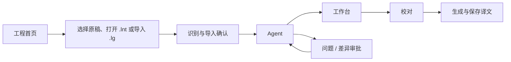

# 原生 Android UI 重做规格

本规格取代 LNT 旧书架/阅读器导航和 Apple 组件约束。页面功能与 [功能矩阵](FEATURE_MATRIX.md) 对齐，技术责任见 [目标架构](ARCHITECTURE.md)。这是设计与验收输入，尚未生成新界面或执行视觉验证。

## 1. 产品体验

用户进入应用后创建或打开工程，默认进入 Agent；也能直接在工作台启动翻译、在校对台编辑译文。模型、规则、提示词、技能、设置和日志均可独立访问。工程原稿与工作区资料可预览，不重新引入以阅读进度为中心的旧产品。

基本流程：

默认入口不代替其他模式：不能强迫用户先聊天才能翻译，也不能让所有工程写操作都经过模型。

## 2. 原生导航

| 布局 | 结构 | 必须保留 |
|---|---|---|
| 无活动工程 | 工程首页 + 模型/设置/技能入口 | 创建、打开、最近工程与迁移状态 |
| 手机有工程 | 顶部工程/运行状态；底部 Agent、工作台、校对、更多 | 全页面入口、后台任务返回、工程切换 |
| 中等宽度 | 紧凑导航 rail；内容和可展开详情 | 相同 route 与页面草稿 |
| 宽屏/平板 | LG 分组导航侧栏；主区 + 可选详情/资料区 | 完整表格、侧栏与资料并排 |

宽度分档起点采用 600dp / 840dp，并在折叠屏、多窗口与横屏实际测量后调整。分档只改变布局，不创建另一套业务状态。手机“更多”按工程工具、模型与运行、应用设置分组，所有功能最多两级可达。

顶部显示工程名、活动任务和状态；存在不可中断提交时说明正在收尾。主导航不展示数据库、Koog、脚本引擎或其他实现细节。

返回顺序：关闭临时浮层/键盘 → 返回详情列表 → 离开页面 → 工程首页/系统返回。返回不自动停止翻译。切工程必须经 Runtime 判定和关闭流程，不能只换路由。

## 3. 视觉系统

当前设计输入是 LG `DESIGN.md`、现有 CSS tokens、导航和页面工作流。以代码实际样式核对设计文件漂移，R30 记录截图来源、版本和覆盖视口。

保留 LG 的克制、偏工具型视觉：浅灰/深灰工作区、暖橙主色、清楚的边界、紧凑信息、少量圆角。重做为原生 Compose，不复用 LNT 旧 Apple 主题，也不把桌面小字号/鼠标高度直接换成 dp。

| token | 浅色起点 | 深色起点 | 使用规则 |
|---|---|---|---|
| 背景 | `#f3f4f6` | `#111318` | 工程/导航背景 |
| 内容面 | `#fbfcfd` | `#171a20` | 列表、面板、编辑器 |
| 正文 | `#25272c` | `#eef1f5` | 按对比度验收 |
| 主色 | `#ad5a17` | `#f49a51` | 主要操作和选中态 |
| 边界 | `#d6dae0` | `#343a44` | 不用大量高对比框制造噪声 |

- 正文建议 14–16sp，辅助信息 12–14sp，代码单独使用等宽字体；实际用五语长文本和字体放大验收。
- 间距以 4/8dp 为基本刻度，内容卡 12–16dp，圆角约 4–8dp。视觉可紧凑，但可点击区域至少 48dp。
- 系统动态配色不默认覆盖 LG 色彩身份；深浅色、跟随系统保持一致的语义 token。
- 状态同时提供文案/图标，不仅以红绿区分。动作危险程度由实际行为决定，不把全部写操作都染成警告色。
- 不加入与工作流无关的营销首页、装饰图、常驻教学气泡或重复确认。

## 4. 页面目录与详细要求

所有 route 名为规划名，R30 可按实际导航 API 调整，但页面职责与功能不可遗漏。项目外页面保留来源页面以支持返回。

### U01 工程首页：`projects`

显示新建、打开、最近工程、名称/访问时间/来源和失效状态。卡片菜单提供复制/移除最近记录，移除记录与删除实际工程必须区分。保留现有工程直到替换工程成功打开。提供旧数据迁移档案入口，允许只读回看无归属会话；需要继续时转入 U02 显式选择目标工程，不默认取第一个工程。

新建流程选择文件、多个文件或目录；展示识别格式、相对路径、数量、实际预算、解析警告与命名冲突。失败明确到文件；允许返回选择和重试，不静默丢文件。原生工程默认打开/保存 `.lnt`；另提供“导入 LG 工程（.lg）”，转换为新的私有 `.lnt` 实例后使用。两类入口均显示设置对齐/版本问题，取消或转换失败不修改源工程，也不发布不完整的活动工程。文件筛选与默认保存名称使用各自扩展名，实际格式仍须校验。

再次选择已导入文件时，明确打开已有工程或导入副本；发现外部内容变化时提供保留本地、导入副本或替换本地，替换前说明会保护旧副本。复制/恢复后的历史可以回看，未完成操作不会自动执行。UI 采用用户可理解的动作名称，不展示内部实例 ID、代际或事务实现细节。具体身份规则见 ARCHITECTURE §3.4。

首次升级的旧数据迁移卡片显示进度、失败项、继续和档案入口；没有旧数据时不出现空迁移流程。

### U02 Agent：`project/{projectId}/agent`

对话区显示用户、助手、工具调用/结果、doing、压缩记录、错误/停止终态及用量。工具行可展开参数与真实回执，大内容按需加载；流式预览独立于已保存时间线。

输入区支持多行、附件、模型选择、发送、停止、排队、执行中引导和队列草稿编辑。动作可用性来自 Runtime，不由按钮本地猜测。发送后输入框只清除已受理草稿，用户新输入保持。

手机资料区使用全屏详情或底部面板；宽屏并排资料/文件区。文件预览包含代码/Markdown/文本、图片、PDF 和产物下载/保存，支持定位与返回原滚动位置。

历史编辑/分支显式标记当前分支，说明后续上下文将变化；不得暗示工程结果也已回滚。重置前说明会删除的 Chat 与材料范围，工程事实独立。

空白、无模型、工具失败、会话故障和可恢复中断各有自然入口。缺失能力显示具体原因，不让模型编造操作成功。

### U03 工作台：`project/{projectId}/workbench`

显示文件/容器列表、类型、总条目、成功/错误/跳过统计、工程完成率、本轮进度和请求恢复状态。选择文件可查看局部统计和操作范围；手机行展开次要字段，宽屏显示表格。

提供追加导入、资产管理、翻译开始/继续/重置、停止、失败项重试、译文/双语生成和输出清单。重置必须预览范围；停止状态显示“正在停止/收尾”，不可在资源仍活动时显示完全空闲。

请求等待密钥恢复/限流时显示原因与下一重试事实，计时从后端事实计算。输出成功后提供保存文件、保存目录或分享，而不是桌面的“打开输出文件夹”空动作。

### U04 校对：`project/{projectId}/proofreading`

顶部有文件、状态、警告、术语和文本搜索筛选；展示命中计数与当前查询范围。搜索结果编辑后保持原窗口成员和顺序，显式重新查询才重排。

手机用原文/译文条目列表 + 全屏编辑器，姓名字段单独呈现；宽屏采用可调整列宽的对照表和详情。提供上一条/下一条、选区、批量状态、清空译文、查找替换预览与提交。

查找替换明确“当前选择/全部筛选结果”，预览匹配内容与实际影响数量。冲突保留未提交文本，允许重读当前值并重新准备。六类警告展示实际证据和关联规则；无警告不等于译文正确。

PDF 按原页展示处置、原页预览和译稿，不强行伪装成普通文本 Item。翻译页可以在原页与排版预览之间切换。

### U05 术语表：`project/{projectId}/glossary`

支持查询、添加、编辑、删除、批选、启用、排序、备注、姓名/正文适用范围、命中统计与校对跳转。手机编辑器使用完整表单，长备注不塞进单行弹窗。

导入先显示重复四分类、skip/overwrite 结果和数量；用户确认后才写工程。预设管理与工程规则分开。导出提供实际支持格式与保存结果。

### U06 文本保护：`project/{projectId}/text-preserve`

提供模式、启用、正则/说明、顺序、预设、导入导出和匹配证据。保存前显示具体错误位置，保留输入。规则试验使用用户显式提供的小样本，不偷偷把整份原稿送模型。

### U07 译前/译后替换：`project/{projectId}/replacement/{pre|post}`

共用原生编辑器，标题与保存目标清楚区分。支持源/目标、正则/字面、大小写、启用、排序、批量操作与预览。反向引用、转义、换行和空目标必须可输入、可回读。

### U08 自定义提示词：`project/{projectId}/prompts`

提供启用、当前正文、恢复默认、风格预设、预设读写与来源。代码编辑器支持撤销/重做、选择、查找和外接键盘；不要求完整 IDE。未保存离开可保存、保留草稿或放弃，不因切语言丢内容。

### U09 技能与人格：`skills`

技能列表区分来源、启用、可见性、自动调用限制和覆盖关系，允许排序、显式引用与管理用户包。展示资源树、文件类型、文本编辑/预览、建立/重命名/删除和版本冲突。

人格单独编辑，说明是应用级偏好；不能把人格当工程规则。运行中不能安全修改的动作由服务拒绝并保留编辑草稿，UI 不预先伪造保存成功。

### U10 模型：`models`

列表按 LG 预设/自定义类型分组，支持用途选择、复制、排序、删除与新增。编辑包含协议/端点、认证、模型、能力、思考/服务档位、生成参数、输入/输出预算、RPM/并发及额外请求字段。

API Key 默认遮挡；支持多个 Key 与独立状态。OAuth 提供登录/取消/退出/刷新异常恢复；供应商登录与模型测试分开。测试按钮显示运行/取消/结果，不能在进入页面时自动消耗请求。

### U11 基础设置：`settings/basic`

覆盖 LG 的应用语言、主题、源/目标语言、工程保存策略、默认预设、输出交付和存储入口。桌面路径项映射为私有存储/用户授权 URI 与保存位置策略，并明确当前实际生效位置。

语言切换覆盖全应用五语，输出目录/工程资源定位不依赖界面语言，旧语言导出结果仍可交付。

### U12 专家设置：`settings/expert`

覆盖请求超时、前文阈值等 LG 专家参数及其生效范围。表单显示单位、边界和默认值，非法输入在提交前说明，服务层仍做相同验证。不要把当前不生效字段展示成可配置功能。

### U13 实验室：`settings/laboratory`

覆盖 ruby 清理、提示词增强、MTool、重复来源及源代码仍存在的实验字段。字段归属与默认值从固定基线形成清单，明确工程/应用作用域和下一轮生效时机。

### U14 日志与诊断：`logs` / `logs/{recordId}`

列表仅加载轻量记录，按文件/范围分页，详情按需读取。提供筛选、复制、实际脱敏导出和错误上下文定位。清理日志与删除工程/历史分开。

Debug 默认关闭，开启只影响新记录。导出前显示可能包含正文的范围，不暴露密钥。游标失效提供重新加载；不要将日志作为会话恢复来源。

### U15 文件、输出与存储：`project/{projectId}/files` / `storage`

文件/产物清单包含来源、名称、大小、类型、更新时间和可用状态。保存单文件、多文件目录和分享使用 Android 适配；保存取消不删除源产物。

存储页显示当前私有工程、材料和缓存占用、迁移/导出结果及可安全清理范围。清理前区分再生缓存、工作区材料与持久工程事实；当前执行材料受保护。

分开提供“保存 LNT 工程（.lnt）”“导出 LG 工程（.lg）”和“完整备份”，显示各自包含的历史、附件/材料范围与兼容限制；`.lg` 必须经过兼容转换，不能把原生工程改后缀导出。完整备份缺材料时不能报成功；恢复前显示目标、版本和需重新认证的配置，默认恢复为新工程。保存失败保留可重试产物，外部目标已变化时提供另存或经明确选择覆盖，不静默覆盖。

## 5. 跨页面交互契约

### 5.1 问答与审批

- 普通问题与工程审批使用不同模型和控件，不以一次聊天“好的”自动批准未展示差异。
- 审批显示工程名、变更对象数、固定差异、冲突策略和允许一次/拒绝；自动偏好入口独立。允许部分接受时，说明关联对象失败会一起跳过，并在结果中列出实际提交/拒绝项。
- 弹层/全屏页面随屏幕变化切换形态，审批 ID 保持。进程重启显示实际待决状态，不从 Compose 本地变量恢复批准。
- 普通问答若配置自动选择，后台/焦点不可操作时暂停计时；写审批没有自动倒计时批准。待决审批可选的绝对截止时间在后台仍经过，到期只返回过期，不代替用户允许。
- 区分“等待批准”“已批准，等待保存”“已保存，状态待同步”和“未保存/冲突”。重试查询或恢复同一操作，不能因连续点击再提交一次；恢复后须重新审批时保留旧结果供核对。
- 等待期间可离开页面，返回后按真实状态继续；结束旧任务或切工程须解决旧待决操作。进程重启不自动重新发起模型请求。

### 5.2 草稿、选择与刷新

草稿按本地工程实例/恢复代际及 Project/Chat/对象身份保存。配置变化不清草稿，主动切对象要保存/保留/放弃。重新关联外部工程时检测变化，不覆盖尚未提交的输入；旧代际草稿可供用户查看/迁移，但不直接应用到替换后的工程。

筛选、选区、编辑文本与运行任务分层。导航离开不触发隐式提交；刷新成功才替换可见内容。新结果不能让滚动列表无故跳顶。

### 5.3 错误反馈

命令调用方负责一次结果通知；页面内错误用于字段校验和可恢复上下文，避免 toast、snackbar、对话框三次重复报错。已经提交但同步失败明确要求重载，重试按钮不得重复应用写入。

对话失败保留历史与草稿，上传失败保留可重试选择，导出失败保留成功产物并列出失败项。每个错误都有可执行恢复路径或明确需用户补充的信息。

### 5.4 系统适配

支持 IME 遮挡、边到边、安全区、横屏、多窗口、外接键盘和系统返回。上传/下载/分享/SAF 权限请求必须有真实终态，不把“发起 Intent”当成已保存文件。

长任务通知可返回实际 Project/Run，Stop 复用同一命令入口。没有活动任务时不常驻空通知。

## 6. 性能、国际化与可访问性

大工程列表采用稳定 ID 和分页/窗口读取；正文、图片、工具结果按需加载。流式文字局部重组，进度不迫使整页重组；图片解码、文件解析与统计不在主线程。

新文案以 Android 字符串资源为权威，覆盖 zh/en/ja/ko/de，与 LG 当前五语能力对齐。复数、占位符、长路径、代码段和数字格式分别校验；模型提示词/技能属于运行时资源，不混入可见 UI 字符串。

TalkBack 标签复用可见动作语义，状态提供可读文本，焦点顺序与视觉一致；流式内容避免每 token 打断朗读。测试 1.0/1.3/2.0 字号、触摸探索、对比度、滚动及键盘焦点。仅 hover、右键、双击才可发现的操作必须有可见触屏入口。

## 7. 视觉验收矩阵

| 场景 | 设备/视口 | 必须实际查看的状态 |
|---|---|---|
| 小屏竖屏 | 360dp、390dp、412dp 等代表设备 | 全部 U01—U15；空、加载、有内容、失败、编辑、弹层 |
| 横屏/多窗口 | 手机横屏、600dp 附近 | 导航切换、IME、表格和资料区 |
| 平板/宽屏 | 840dp+ | rail/侧栏、对照表、代码、审批与资料并排 |
| 长内容 | 长路径、长 JSON、长日/德文、长对话 | 换行、横滚、截断、复制与实际选区 |
| 系统干扰 | 旋转、后台回来、权限拒绝/撤销 | 草稿、焦点、审批、任务与文件交付 |

截图使用真实 Compose 页面，截图后必须人工查看。Roborazzi 可做已审核基线回归，真机用于 IME/SAF/通知/字体与 native 预览。HTML mock、组件计数或语义树通过都不能替代原生界面验收。

R30 先完成工程首页、Agent、校对和模型编辑四个代表页面的交互原型，再推广到全页面；原型使用假数据且不写用户工程。视觉确认后的 token 和组件才成为全局基线。没有实际截图时只记录“规格完成”，不能写“UI 已验证”。

视觉原型后按 IMPLEMENTATION_PLAN §4.2 交付 S1/S2 最小真实界面：先完成 TXT 手动翻译/校对/保存/重开，再接 Agent 查询和审批写入。使用真实存储与应用服务、假模型；在此阶段验证手机布局、IME、失败保留、审批恢复和 SAF。未接入的页面/操作保持未验收，不以局部切片关闭全部 UI 任务。
